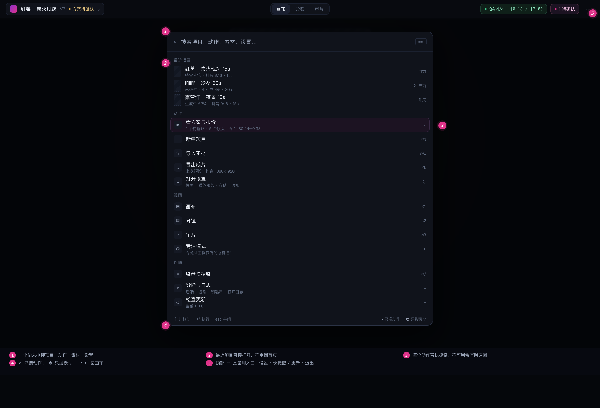

# Ad+ 入口地图 v3

| 项 | 内容 |
|---|---|
| 版本 | v3.0-draft |
| 日期 | 2026-11-05 |
| 关系 | 补充 [交互重设计 v3](interaction-redesign-v3.md) 的入口层；不改数据模型与接口 |
| 线框 | [命令面板](wireframes/06-command.html) · [画布](wireframes/04-canvas.html) · [审片](wireframes/05-review.html) |

---

## 0. 结论

- **少界面 ≠ 少入口。** 入口可以很多，但必须分层：常用的常驻、低频的进菜单、对象相关的进右键。
- **入口分七层：** macOS 原生菜单 / 常驻 UI / 全局浮层 / 项目浮层 / 对象级 / 设置与诊断 / 空态与错误。
- **所有入口由一份 Action Registry 生成。** 原生菜单、`⌘K`、快捷键、右键菜单共享同一份定义，避免“菜单里有、面板里没有”的漂移。
- **一条硬规则：任何功能必须能在 `⌘K` 里按名字搜到，否则不算上线。**

---

## 1. 现状审计

| 入口 | 现在在哪 | 问题 |
|---|---|---|
| 新对话 | 左栏顶部 | 语义是会话，不是项目；没有“新建项目” |
| 历史会话 | 左栏列表 | 无搜索、重命名、删除、分组；同名无法区分 |
| 设置 | 左栏底部齿轮 | 只有 4 个 tab：模型 / 媒体服务 / Pi 集成 / 关于 |
| 模型切换 | 顶栏胶囊 | 占视觉 C 位；对用户是实现细节 |
| 上传素材 | 输入框回形针 | 文档说支持拖拽/粘贴，代码里没有 |
| 审批 | 输入框上方 `AskDock` | 不按项目过滤；132px 预览无法判断 |
| 任务 | 右栏，仅运行时 | 无历史、无失败原因、无重试 |
| 产物 | 右栏缩略图 | 无下载、无 Finder、无删除；`/api/reveal`、`/api/trash` 未接 |
| 项目列表 | **无 UI** | `/api/projects` 已实现但无人调用 |
| 素材库 | **无 UI** | `/api/uploads` 已实现但无人调用 |
| 输出目录 | **无 UI** | `/api/config` 已实现，仅设置页之外不可达 |
| 流水线阶段 | **无 UI** | `/api/workspace` 已实现，SPA 未接 |
| 原生菜单 | **代码中未定义** | `app/desktop/src/main.rs` 未构建 menu；即使系统兜底了 App 菜单，也没有 文件 / 视图 / 项目 / 帮助 与 `⌘N`、`⌘O`、`⌘E` 等业务命令 |
| 通知 | **无** | 后台审批只能靠页面轮询，极易错过 |
| 帮助 / 快捷键 / 诊断 | **无** | 出问题只能看日志文件 |
| 更新 | **无** | 只能重新下载安装包 |

> 结论：v3 的“少界面”成立的前提，是先把这些入口**补到正确层级**，而不是继续塞进画布。

---

## 2. 七层入口模型

| 层 | 触发 | 放什么 | 数量约束 |
|---|---|---|---|
| **L0 原生菜单** | 系统菜单栏 / 快捷键 | 标准命令、当前上下文命令 | 固定 7 个菜单 |
| **L1 常驻 UI** | 始终可见 | 项目状态、模式、主操作、待办、状态药丸、`⋯`、Dock | ≤ 7 个区域 |
| **L2 全局浮层** | `⌘K` / `⌘O` / `⌘J` / `⌘,` / `⇧⌘I` / `⌘E` | 命令、项目、对话、设置、导入、导出 | 每个一个快捷键 |
| **L3 项目浮层** | 点项目 chip | 简报、流程、版本、交付、项目设置 | 一个 popover |
| **L4 对象级** | 右键 / 选中 | 镜头、版本、产物、任务、消息 | 每个对象 ≤ 7 项 |
| **L5 设置与诊断** | `⌘,` / Help | 模型、媒体、品牌、存储、通知、快捷键、高级、关于 | 8 个 tab |
| **L6 空态/错误态** | 自动出现 | 起始卡、无模型、后端不可用、渲染失败、审批超时 | 每个状态一个出口 |

---

## 3. L0：macOS 原生菜单（当前缺失，必须补）

> 桌面应用缺少完整的原生菜单，是“像网页”的最大来源；补上它反而能让页面更干净——低频功能不必出现在画布上。

### 3.1 App 菜单

| 菜单项 | 快捷键 | 行为 |
|---|---|---|
| 关于 Ad+ | — | 打开设置 · 关于 |
| 设置… | `⌘,` | 打开设置浮层 |
| 检查更新… | — | 检查更新（P1） |
| 服务 | — | 系统标准 |
| 隐藏 Ad+ | `⌘H` | 系统标准 |
| 隐藏其他 | `⌥⌘H` | 系统标准 |
| 退出 Ad+ | `⌘Q` | 退出并回收后端进程 |

### 3.2 文件

| 菜单项 | 快捷键 | 行为 |
|---|---|---|
| 新建项目… | `⌘N` | 打开起始卡 |
| 打开项目… | `⌘O` | 项目切换浮层 |
| 打开最近 | — | 子菜单：最近 5 个项目 |
| 导入素材… | `⇧⌘I` | 文件选择；落到项目 assets |
| 导出成片… | `⌘E` | 用上次预设导出；`⌥` 打开预设 |
| 在 Finder 中显示 | `⇧⌘R` | 当前项目目录 |
| 关闭窗口 | `⌘W` | 系统标准 |

### 3.3 编辑

标准 `Undo / Redo / Cut / Copy / Paste / Select All`。
- P0 只保证输入框内的标准编辑；画布操作（删镜、移镜）的撤销在 P1 接。
- 若暂不支持撤销，菜单项置灰并写明“暂不支持”，不要静默无效。

### 3.4 视图

| 菜单项 | 快捷键 | 行为 |
|---|---|---|
| 项目 | `⌘⇧1` | 切到项目模块 |
| 制作 | `⌘⇧2` | 切到制作模块 |
| 资产 | `⌘⇧3` | 切到资产模块 |
| 任务 | `⌘⇧4` | 切到任务模块 |
| 画布 | `⌘1` | 制作 · 画布 |
| 分镜 | `⌘2` | 制作 · 分镜 |
| 审片 | `⌘3` | 制作 · 审片 |
| 专注模式 | `F` | 隐藏除主操作外的控件 |
| 导演对话 | `⌘J` | 展开 / 收起右侧对话 |
| 命令面板 | `⌘K` | 打开 ⌘K |
| 进入全屏 | `⌃⌘F` | 系统标准 |

> 菜单里的勾选状态跟随当前模块与子 tab；不可用的项置灰（例如没有成片时“审片”不可用）。

### 3.5 项目

| 菜单项 | 行为 |
|---|---|
| 简报… | 打开项目浮层的简报段 |
| 品牌包… | P1；P0 置灰 |
| 版本… | 版本列表 / 对比 / 回滚 |
| 交付物… | 导出历史 |
| 项目设置… | 平台 / 比例 / 时长 / 质量档 |
| 复制项目 | 复制 brief 与品牌，生成新 id |
| 归档 | 从进行中移出 |
| 删除… | 二次确认 → 废纸篓 |

### 3.6 窗口 / 帮助

- 窗口：最小化 `⌘M`、缩放、全部置于前面。
- 帮助：Ad+ 帮助、键盘快捷键 `⌘/`、诊断与日志、打开日志文件、报告问题。

---

## 4. L1：常驻 UI

| 元素 | 位置 | 点击 | 备注 |
|---|---|---|---|
| 主模块 | 底栏左 | 项目 / 制作 / 资产 / 任务 | 4 个；当前项顶部 2px 主色线 |
| 项目 chip | 顶栏左 | 当前项目总览（简报 / 版本 / 交付） | 唯一的项目上下文入口 |
| 子 tab | 顶栏中 | 当前模块的视图 | 制作 = 画布 / 分镜 / 审片 |
| 主操作 | 顶栏右 | 看方案与报价 / 生成 / 导出 | 全屏唯一主按钮 |
| 状态药丸 | 底栏右 | QA 详情 + 花费明细 | 异常才变红 |
| 待办 | 底栏右 | 直接进审片 | 有数量与超时颜色 |
| 设置 / 帮助 | 底栏最右 | 设置 / 快捷键 / 诊断 | 工具，不是模块 |
| 导演药丸 | 右侧 | 展开导演对话 | `⌘J`；不占一级导航 |

> 没有头像：这是本地单用户工具，头像是一个假的可点击物。
>
> 导航层级以 [模块与导航 v3.2](module-map-v3.md) 为准：4 个主模块在底栏，当前模块的子 tab 在顶栏；聊天、设置、帮助不是一级模块。

---

## 5. L2：全局浮层

### 5.1 `⌘K` 命令面板（功能兜底）



- 一个输入框搜：项目、动作、素材、设置、帮助。
- 分组：最近项目 / 动作 / 视图 / 帮助；输入后只显示匹配，最多 12 行。
- 每行显示快捷键；不可用动作写明原因（“无成片可导出”）。
- 前缀：`>` 只搜动作，`@` 只搜素材，`#` 只搜项目。
- `↑↓` 选择、`↵` 执行、`esc` 关闭；关闭后回到原画布与原播放点。
- 空结果给建议：“试试 导出 / 分镜 / 设置”。

### 5.2 `⌘O` 项目切换

- 最近项目卡片（封面、标题、状态、平台/时长、更新时间）。
- 顶部搜索；底部“新建项目”“打开文件夹”。
- 没有项目时就是起始卡。

### 5.3 `⌘J` 导演对话

- 420px 浮层，覆盖画布但不 resize。
- 头部：制作记录切换、新记录、模型 chip。
- 内容：消息、工具时间线、审批卡（可点开审片）。
- 底部：输入、附件、停止。

### 5.4 `⌘,` 设置

8 个 tab：

| tab | 内容 | P |
|---|---|---|
| 模型 | 文本模型、默认模型、测试连接 | P0 |
| 媒体服务 | 图像/视频/语音/音乐 key、能力矩阵、搜索 | P0 |
| 品牌包 | logo、色、字体、口播人设、禁用词 | P1 |
| 输出与存储 | 输出目录、项目目录、磁盘占用、清理缓存、废纸篓 | P0 |
| 通知 | 桌面通知开关、审批提醒、完成/失败提醒 | P0 |
| 快捷键 | 完整键位表 | P0（只读）；P2 可改 |
| 高级 | Pi 集成、信任、运行时路径、诊断、日志 | P0 |
| 关于 | 版本、检查更新、许可、数据目录 | P0 |

- 每个 tab 可被 `⌘K` 直接打开（“打开媒体服务设置”）。
- 设置内搜索：模型/媒体 key 数量多，必须有搜索。

### 5.5 导入 / 导出

- `⇧⌘I` 导入：文件选择 + 拖拽 + 粘贴；选择“作为参考 / 替换镜头 / 素材”。
- `⌘E` 导出：上次预设一键；`⌥⌘E` 打开预设（平台、封面、SRT、命名）。

---

## 6. L3：项目浮层（点项目 chip）

这是原来的“项目首页”，折叠成一个 360px popover：

```
┌ 项目 ──────────────────────────────┐
│ 红薯 · 炭火现烤 15s   [待审分镜]    │
│ 抖音 · 9:16 · 15s · 标准档          │
├ 流程 ──────────────────────────────┤
│ 简报 ✓ → 方案 ● → 分镜 ○ → 生成 ○  │
│ 待办 1：分镜待确认        [去确认]  │
├ 版本 ──────────────────────────────┤
│ V3 当前 · V2 · V1        [对比]     │
├ 交付 ──────────────────────────────┤
│ vertical-15s-v3.mp4      [导出]     │
├ 项目 ──────────────────────────────┤
│ 简报… 项目设置… 复制 归档 删除…     │
└────────────────────────────────────┘
```

规则：
- 只放“项目级”的事，不放全局设置。
- 版本、交付、待办都在这里，不再单独做页面。
- 项目设置（平台/比例/时长/档位）改完若影响已批准版本，自动作废旧批准。

---

## 7. L4：对象级入口

| 对象 | 左键 | 右键 / 更多 |
|---|---|---|
| 镜头 | 选中 → 浮动检查器 | 重做 / 锁定 / 打回 / 复制 / 删除 / 导出该镜 / 定位时间轴 |
| 版本 | 切换 | 对比 / 设为当前 / 重命名 / 导出 / 回滚 |
| 产物 | 预览 | 下载 / 在 Finder 显示 / 删除 / 用作参考 |
| 任务 | 展开详情 | 取消 / 重试 / 打开日志 / 复制错误 |
| 消息 | 选中文本 | 复制 / 重试本条 / 打开产物 |
| 时间轴 | 拖动播放头 | 插入镜头 / 拆分 / 删除（P1） |

约束：
- 右键菜单最多 7 项，危险项（删除）分隔线后置底。
- 所有右键项必须在 `⌘K` 有同名动作（可搜索、可配快捷键）。
- 选中态才出现的操作，不能是唯一入口；`⌘K` 永远兜底。

---

## 8. L5：设置与诊断（补齐当前缺口）

必须新增的入口（现在完全没有或藏在 API 里）：

| 缺口 | 入口 | 行为 |
|---|---|---|
| 输出目录 | 设置 · 输出与存储 | 选择目录、恢复默认、打开 Finder（`/api/config` 已就绪） |
| 磁盘占用 / 清理 | 设置 · 输出与存储 | 项目/缓存/废纸篓大小；清理中间产物 |
| 通知 | 设置 · 通知 | 审批/完成/失败；系统通知权限状态 |
| 快捷键 | `⌘/` / 设置 | 完整键位表；冲突提示 |
| 诊断 | Help / 设置 · 高级 | Python/Node/ffmpeg/Remotion 版本；钥匙串状态；MCP 连接；复制诊断 |
| 日志 | Help · 打开日志 | `~/Library/Application Support/Ad+/app.log` |
| 更新 | App 菜单 / 关于 | 检查更新（P1）；当前版本 |
| Pi 集成 | 设置 · 高级 | 已有，挪到“高级”，不要占一级 tab |
| 关于 | App 菜单 / 设置 | 版本、许可、数据目录 |

> 原则：**配置进设置，状态进浮层，动作进 ⌘K，诊断进 Help。** 四者不混。

---

## 9. L6：系统与 OS

| 能力 | 现状 | 设计 |
|---|---|---|
| 系统通知 | 无 | 审批待办、生成完成、失败；点击聚焦对应项目与状态 |
| Dock 徽标 | 无 | 待办数量（P1）；不打扰，不弹窗 |
| 菜单栏常驻 | 无 | P2：生成进度 / 待办；默认关闭 |
| 单实例 | 第二次启动直接退出 | 改为聚焦已有窗口（`open -a` 行为） |
| 打开最近 | 无 | File > 打开最近 / `⌘O` 顶部 |
| 自动更新 | 无 | P1：App 菜单 + 关于；下载后重启提示 |
| 崩溃与日志 | 只有文件 | 错误页给“打开日志/复制诊断” |
| 文件关联 | 无 | P2：拖入 `.mp4/.png` 直接导入 |

---

## 10. L6：空态与错误态的出口

| 状态 | 页面表现 | 必须有的入口 |
|---|---|---|
| 没有项目 | 起始卡 + 最近项目 + 示例 | 从零描述 / 模板 / 导入 / 打开最近 |
| 没有模型 | 引导页 | 去设置模型 / 看为什么需要 |
| 没有媒体 key | 方案卡里解释档位差异 | 去配媒体 key / 先用本地档 |
| 后端不可用 | 诊断页 | 重试 / 打开日志 / 复制诊断 |
| 渲染失败 | 任务卡标红 | 查看原因 / 重试 / 打开日志 |
| 审批超时 | 待办变“已超时” | 重新发起 / 查看方案 |
| 导出失败 | 导出结果页 | 重试 / 换预设 / 打开日志 |

---

## 11. 入口规则（防止再次长回来）

1. **先注册 action，再决定入口。** 没有 action id 的功能不允许进 UI。
2. **频率决定层级**：每次用 → 常驻；每周用 → 菜单/`⌘K`；配置 → 设置；诊断 → Help。
3. **不新增顶级导航**：没有第二个侧栏、没有第二个顶栏 tab。
4. **`⌘K` 是兜底**：任何功能搜不到，就不算完成。
5. **同源生成**：原生菜单、`⌘K`、快捷键、右键菜单都从 Action Registry 生成。
6. **文案是动词 + 对象**：“导出成片”，不是“导出”；“重做此镜”，不是“重做”。
7. **危险操作二次确认 + 可撤销**：删除进废纸篓，10 秒内可撤销。
8. **不可用要解释**：置灰必须带原因，不能静默失败。

---

## 12. Action Registry（工程契约）

```ts
type Action = {
  id: string;                 // "project.export"
  title: string;              // "导出成片"
  group: "project" | "view" | "edit" | "asset" | "settings" | "help";
  shortcut?: string;          // "Cmd+E"
  icon?: string;
  when?: (ctx: AppContext) => boolean;      // 是否显示
  enabled?: (ctx: AppContext) => boolean;   // 是否可点
  reason?: (ctx: AppContext) => string;     // 置灰原因
  run: (ctx: AppContext) => void | Promise<void>;
};
```

- `AppContext`：当前项目、版本、选中的镜头、运行中的任务、是否有成片、是否在审片。
- 四个消费端：`buildMenu() / buildPalette() / bindShortcuts() / buildContextMenu()`。
- 每个 action 的 `id` 同时用于埋点；入口点击率与功能使用率天然对齐。
- 新增功能只改注册表，不改四处 UI。

---

## 13. 覆盖检查表

| 功能 | 入口 | 层 | 快捷键 | P |
|---|---|---|---|---|
| 新建项目 | 起始卡 / 文件菜单 / ⌘K | L0/L2 | `⌘N` | P0 |
| 切换项目 | ⌘O / ⌘K / 文件菜单 | L2 | `⌘O` | P0 |
| 项目设置 | 项目 chip | L3 | — | P0 |
| 简报 | 项目 chip | L3 | — | P0 |
| 版本 / 回滚（对比 P1） | 项目 chip / 版本 chip | L3/L4 | — | P0 |
| 交付物 | 项目 chip | L3 | — | P0 |
| 复制 / 归档 / 删除项目 | 项目 chip / 项目菜单 | L3/L0 | — | P0 |
| 导入素材 | 文件菜单 / ⌘K / 拖拽 / 粘贴 | L0/L2 | `⇧⌘I` | P0 |
| 模板 | 起始卡（P1） | L2 | — | P1 |
| 选镜 / 检查器 | 画布点镜头 | L1/L4 | — | P0 |
| 重做镜头 | 检查器 / 右键 / ⌘K | L4 | `R` | P0 |
| 锁定镜头 | 检查器 / 右键 | L4 | `⇧L` | P0 |
| 打回镜头 | 审片卡 / 右键 | L4 | `X` | P0 |
| 添加 / 删除镜头 | 分镜态右键 / ⌘K | L4 | — | P1 |
| 审片 | 待办 / 模式开关 / 通知 | L1/L2 | `⌘3` | P0 |
| 全部通过 / 全不选 | 审片头部 | L1 | `A` | P0 |
| 修复 QA | 审片决策栏 | L1 | — | P0 |
| 导出成片 | 主操作 / 文件菜单 / ⌘K | L0/L1 | `⌘E` | P0 |
| 导出预设 | `⌥⌘E` / 导出浮层 | L2 | `⌥⌘E` | P1 |
| 下载 / Finder / 删除产物 | 右键 | L4 | — | P0 |
| 导演对话 | Dock / 视图菜单 | L1/L0 | `⌘J` | P0 |
| 新制作记录 | 对话头部 | L2 | — | P1 |
| 切换模型 | 对话头部 / 设置 | L2/L5 | — | P0 |
| 停止生成 | 输入框 / `⌘.` | L1 | `⌘.` | P0 |
| 任务中心 | 任务圆环 / ⌘K | L1/L2 | — | P0 |
| 取消 / 重试任务 | 任务详情 | L4 | — | P0 |
| 命令面板 | `⋯` / 视图菜单 / ⌘K | L1/L0 | `⌘K` | P0 |
| 设置 | `⋯` / App 菜单 / ⌘K | L1/L0 | `⌘,` | P0 |
| 输出目录 / 清理 | 设置 · 存储 | L5 | — | P0 |
| 通知开关 | 设置 · 通知 | L5 | — | P0 |
| 快捷键表 | Help / 设置 | L0/L5 | `⌘/` | P0 |
| 诊断 / 日志 | Help / 设置 · 高级 | L0/L5 | — | P0 |
| 检查更新 | App 菜单 / 关于 | L0/L5 | — | P1 |
| 关于 | App 菜单 / 设置 | L0/L5 | — | P0 |
| 隐藏 / 退出 | App 菜单 | L0 | `⌘H/⌘Q` | P0 |
| 全屏 | 视图菜单 | L0 | `⌃⌘F` | P0 |

---

## 14. 验收

1. 原生菜单存在；`⌘,`、`⌘N`、`⌘O`、`⌘E`、`⌘J`、`⌘K` 全部可用。
2. 上表每一行都能在应用内找到，且 `⌘K` 能搜到。
3. 菜单项与 `⌘K` 的置灰原因一致；不出现“菜单能点、面板不能点”。
4. 任意入口触发的动作有统一 action id，埋点可归因。
5. 后台出现审批，2 分钟内必有系统通知；点击回到对应项目。
6. 设置包含：模型、媒体、存储、通知、快捷键、高级、关于；每项可从 `⌘K` 直达。
7. 所有空态/错误态都有至少一个出口，不出现“只能重启”。
8. 新增功能只改注册表与一个入口，不新增导航层级。

---

## 15. 优先级

| 优先级 | 范围 |
|---|---|
| **P0** | 原生菜单基础版、`⋯` 菜单、项目 chip 浮层、`⌘K`、`⌘O`、设置补齐存储/通知/快捷键/诊断、任务详情、产物右键、系统通知 |
| **P1** | 品牌包、模板、素材库、自动更新、版本对比、导出预设、撤销/重做 |
| **P2** | 菜单栏常驻、可自定义快捷键、文件关联、多窗口 |

---

## 16. 一句话

**画布只留四个入口，剩下的全部收进原生菜单、`⌘K`、项目浮层和右键；再由一份 Action Registry 保证它们不会各自漂移。**
