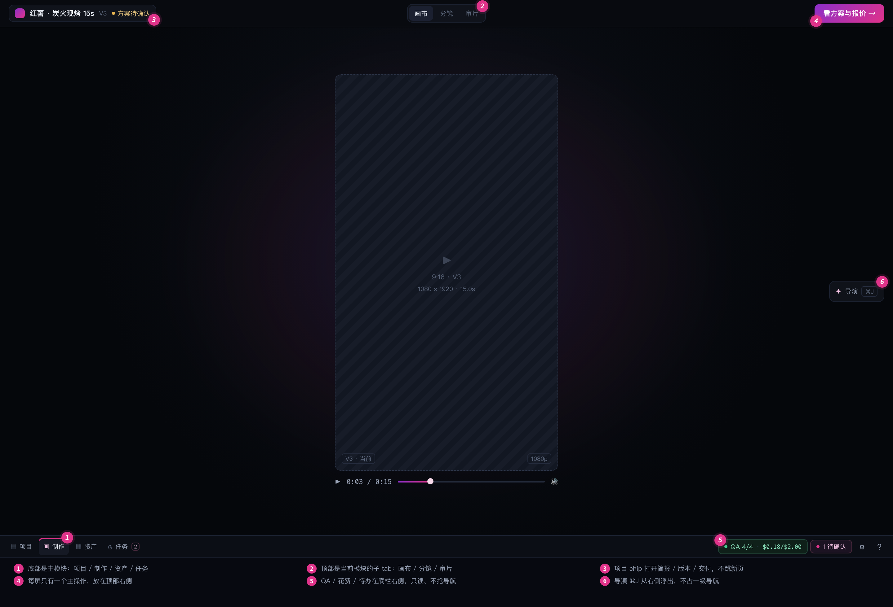

# Ad+ 模块与导航 v3.2

> 状态：**主模块在底栏，子 tab 在顶栏**。画布 / 分镜 / 审片是「制作」模块的子 tab。
> 本文替代 [底部模块坞 v3.1](bottom-dock-v3.md) 中“模式也放底栏”的做法。

| 项 | 内容 |
|---|---|
| 版本 | v3.2-draft |
| 日期 | 2026-11-05 |
| 关系 | 修订 v3 / v3.1 的信息架构；数据模型、接口、审批记录不变 |
| 线框 | [底部主模块 + 顶部子 tab](wireframes/08-bottom-modules.html) |

---

## 0. 结论

- 应用只有 **4 个主模块**：项目 / 制作 / 资产 / 任务。
- **底部** = 主模块切换 + 系统状态（Zed 的语义：工作区开关）。
- **顶部** = 当前项目 + 当前模块的子 tab + 唯一主操作。
- **画布 / 分镜 / 审片** 是「制作」模块的三个子 tab，不是三个主模块。
- 设置、帮助是工具，放底栏右侧；聊天是工具，右侧浮出，不做一级导航。

一句话：**底部回答“去哪个工作区”，顶部回答“在这个工作区看什么”。**

---

## 1. 先想清楚：用户要完成哪些事

| # | 用户任务 | 功能 | 产物 |
|---|---|---|---|
| 1 | 决定做什么 | 新建项目、简报、模板/参考 | Brief |
| 2 | 看方案与价格 | 概念、关键帧、质量档、报价 | Plan / Quote |
| 3 | 做出来 | 画布、分镜、生成、逐镜返工 | Shot / Version |
| 4 | 判断好坏 | 审片、QA、合规 | Review |
| 5 | 交付 | 导出、封面、字幕、下载 | Deliverable |
| 6 | 复用 | 素材、品牌、模板、音乐 | Asset / Brand |
| 7 | 看运行 | 任务、失败重试、花费、日志 | Job |
| 8 | 配置 | 模型、媒体 key、存储、通知、快捷键 | Settings |

这 8 件事不是 8 个平行页面。按“工作区”归并后，只剩 4 个主模块。

---

## 2. 归并成 4 个主模块

| 模块 | 回答的问题 | 包含 | 不包含 |
|---|---|---|---|
| **项目** | 做什么、做到哪、交了什么 | 作品集、新建/简报、项目总览、版本、交付物、归档/删除 | 画布编辑、任务队列 |
| **制作** | 这一条怎么把它做出来 | 画布/分镜/审片、方案闸门、逐镜返工、导演对话、导出动作 | 作品集、素材库 |
| **资产** | 有什么可以复用 | 素材、品牌包、模板、音乐、参考 | 项目状态、渲染任务 |
| **任务** | 机器现在在干什么 | 运行中、失败、重试、花费、日志 | 内容编辑 |

### 2.1 为什么是 4 个，不是 6 个

| 候选 | 不单独做一级模块的理由 | 去向 |
|---|---|---|
| 交付 | 导出是动作；交付物是项目的账本 | 制作（动作）+ 项目（记录） |
| 聊天 / 导演 | 它是当前对象的协作工具，不是目的地 | 制作 · 右侧浮出 `⌘J` |
| 品牌 | 一种可复用资源 | 资产 · 子 tab |
| 模板 | 一种起点/资源 | 资产 · 子 tab；项目 · 新建 |
| 设置 | 配置是打断式任务 | 底栏右侧齿轮 / `⌘,` |
| 帮助 | 低频 | 底栏右侧 `?` / Help 菜单 |

> 判定标准：**能独立占用一块工作区、并且用户会“待在那里”的，才是一级模块。**

---

## 3. 两层导航

```
┌──────────────────────────────────────────────────────────────────────────────┐
│ 44  红薯 · 炭火现烤 15s  V3  ●方案待确认      [ 画布 分镜 审片 ]   [看方案与报价 →] │
├──────────────────────────────────────────────────────────────────────────────┤
│                                                                              │
│                         视频 / 画布 / 分镜 / 审片                            │
│                                                                              │
│                                                          ✦ 导演 ⌘J           │
├──────────────────────────────────────────────────────────────────────────────┤
│ 36  ▤项目   ▣制作   ▦资产   ◷任务 2               QA 4/4 · $0.18  1待确认  ⚙ ? │
└──────────────────────────────────────────────────────────────────────────────┘
```



> 每个模块的字段、交互、状态与验收见 **[页面规格 v3.3](page-specs-v3.md)**。

**层级规则：**

- 底部是**全局的**：4 个模块，跨项目不变。
- 顶部是**上下文的**：当前项目 + 当前模块的子 tab；切模块时子 tab 跟着换。
- 顶部只有一个主操作；底栏只放只读状态与工具。
- 画布 / 分镜 / 审片共享同一个版本、同一个选中镜、同一个时间码。

### 3.1 每个模块的子 tab

| 模块 | 子 tab | 说明 |
|---|---|---|
| 项目 | 全部 / 进行中 / 已交付 | 作品集筛选，不改变工作区 |
| 制作 | 画布 / 分镜 / 审片 | 同一条片子的三种密度 |
| 资产 | 素材 / 品牌 / 模板 | 资源类型 |
| 任务 | 全部 / 运行中 / 失败 | 运行状态 |

> 子 tab 始终在顶部同一位置，只换文案；用户不需要重新学习导航。

---

## 4. 底栏规格

| 区 | 内容 | 规则 |
|---|---|---|
| 左 | 项目 / 制作 / 资产 / 任务 | 4 个；图标 + 11px 标签；当前项顶部 2px 主色线 |
| 右 | QA·花费 / 待办 / `⚙` / `?` | 只读；失败才变红；工具不抢模块位置 |

- 高度 36；单项命中区 ≥28×28。
- 任务有运行时显示数字徽标；审批待办在底栏右侧显示数量。
- 设置/帮助是**工具**，不是模块：放在最右，用图标而非文字。
- 聊天不放在底栏：它是制作里的工具，右侧 `✦ 导演 ⌘J` 浮出。
- 窗口 <1000 时，模块标签保留，QA 文字收成图标 + tooltip。

### 4.1 为什么主模块放底部

- 参考 Zed：底栏是**工作区/面板开关 + 状态**，不是主导航；中间留给内容。
- 底边是窗口边缘，鼠标容易命中（Fitts）。
- 顶部只留“当前项目 + 当前视图 + 主操作”，视觉重心回到片子上。
- 4 个模块足够短，不会变成第二层菜单。

---

## 5. 顶栏规格

| 区 | 内容 | 规则 |
|---|---|---|
| 左 | 项目 chip：标题、V3、状态 | 点开项目总览（简报/方案/版本/交付） |
| 中 | 当前模块的子 tab | **水平居中**；制作 = 画布/分镜/审片；资产 = 素材/品牌/模板；任务 = 全部/运行中/失败 |
| 右 | 唯一主操作 | 看方案与报价 / 生成 / 导出；随状态变文案 |

- 高度 44；项目 chip 高 28；子 tab 是 24 高的分段控件，视觉上弱于底栏模块。
- 子 tab **绝对居中**（`left:50%` + `translateX(-50%)`），不参与左右布局：改项目标题或主操作文案都不会让它位移。
- 居中后，子 tab 与视频中线对齐，视觉重心更稳。
- 不在顶栏放 QA/花费/待办：它们是系统状态，属于底栏。
- 不在顶栏放模型选择：属于设置；制片时不需要看模型名。
- 窗口 <1100 时，项目标题截断；子 tab 仍居中，与项目 chip 的最小间距 ≥24px。

**按钮文案规则**

| 位置 | 文案 | 为什么 |
|---|---|---|
| 入口（方案待确认） | **看方案与报价** | 先说清“点下去会看到什么”，而不是“审阅”这种书面动作 |
| 方案浮层内 | **确认并生成** | 说清结果：确认后开始生成 |
| 方案浮层次操作 | **改一下** | 不跳页、不写长文本，就地改档位/时长/风格 |
| 生成完成 | **导出** | 动作 + 对象，避免“提交/下一步”这类空词 |
| 不用 | 审阅方案 / 确认方案 / 提交 | “审阅”书面、“确认方案”暗示已看过、“提交”像表单 |


---

## 6. 各模块内容

### 6.1 项目

- 头部：新建项目、搜索、导入。
- 作品集：卡片/列表，封面、标题、状态、平台/时长、更新时间、待办徽标。
- 卡片菜单：打开制作、项目总览、复制、归档、删除、在 Finder 显示。
- 空态：起始卡 + 最近项目 + 模板。
- 项目总览（从项目 chip 打开）：简报、方案记录、版本、交付物、花费、项目设置。

### 6.2 制作

- 子 tab：画布 / 分镜 / 审片。
- 画布：视频、transport、细胶片（可折叠）、镜头检查器、主操作。
- 分镜：分镜板网格，排序/增删/逐镜描述。
- 审片：默认全通过、标问题镜、QA、决策条。
- 方案闸门：主操作触发，浮层展示概念 + 3 帧 + 档位 + 价格；批准后进入生成。
- 导演对话：右侧 360 抽屉，`⌘J`；打开即聚焦输入框。
- 版本：顶栏项目 chip 旁或画布内版本 chip；只影响当前项目。

### 6.3 资产

- 子 tab：素材（P0）/ 品牌（P0）/ 模板（P1）。
- 素材：上传、生成物、音乐、参考；网格 + 类型筛选；拖到画布。
- 品牌：logo、色、字体、口播人设、禁用词；一个品牌包可被多个项目引用；P0 需可新建、编辑、应用到项目。
- 模板：广告结构/风格预设；从模板新建项目（P1）。
- 素材是**跨项目**的；项目内引用不复制文件。

### 6.4 任务

- 子 tab：全部 / 运行中 / 失败。
- 行：项目、类型、镜头、进度、耗时、花费、错误。
- 操作：取消、重试、打开日志、复制错误。
- 顶部汇总：运行数、失败数、今日花费。

### 6.5 设置 / 帮助

- 设置：底栏 `⚙` / `⌘,`，模态；模型、媒体服务、存储、通知、快捷键、高级、关于。
- 帮助：底栏 `?` / Help 菜单；快捷键 `⌘/`、诊断、日志、更新。

---

## 7. 制作模块的三个子 tab

| 子 tab | 用途 | 进入条件 | 主要操作 |
|---|---|---|---|
| 画布 | 看片、选镜、改片 | 默认 | 播放、重做、导出、看方案与报价 |
| 分镜 | 排镜、增删、逐镜描述 | 有分镜 | 拖拽排序、添加/删除、逐镜备注 |
| 审片 | 批准、打回、QA | 有版本 | 默认全通过、标问题、批准 |

- 三个 tab 共享选中镜与时间码；切 tab 不丢位置。
- 审片在没有版本时置灰，tooltip 写明“先生成一版”。
- **方案不是子 tab**：它是生成前的闸门，以主操作/浮层出现；批准后成为项目总览里的记录。

---

## 8. 入口与快捷键

| 动作 | 入口 | 快捷键 |
|---|---|---|
| 切换主模块 | 底栏模块 | `⌘⇧1/2/3/4` |
| 切换子 tab | 顶栏子 tab | `⌘1/2/3` |
| 项目总览 | 项目 chip | `⌘O` 打开项目库 |
| 导演对话 | 右侧 `✦ 导演` | `⌘J` |
| 命令面板 | 底栏 / 任意处 | `⌘K` |
| 设置 / 帮助 | 底栏右侧 | `⌘,` / `⌘/` |
| 审片 / 导出 | 顶栏主操作 | `⌘3` / `⌘E` |

- 原生菜单 View：主模块 + 子 tab 都列出，勾选当前态。
- `⌘K` 能搜到所有模块、子 tab、动作、项目、素材。
- 右键菜单只放对象级操作；不复制导航。

---

## 9. 与 v3 / v3.1 的差异

| 版本 | 主模块 | 画布/分镜/审片 | 聊天 | 问题 |
|---|---|---|---|---|
| v3 | 无（只有模式） | 顶部居中模式 | 38px Dock | 模块入口靠猜 |
| v3.1 | 底栏 | 也放底栏 | 底栏 `导演` | 把“模式”和“模块”混成一层 |
| **v3.2** | **底栏** | **制作模块的顶部子 tab** | **右侧 `⌘J`** | 层级清晰：底部=工作区，顶部=视图 |

数据模型、接口、审批记录、MCP 契约不变。

---

## 10. 验收

1. 底栏只有 4 个主模块 + 状态/工具，没有画布/分镜/审片。
2. 画布/分镜/审片只出现在「制作」的顶部子 tab；切到资产/任务时子 tab 跟着换。
3. 切模块不丢当前项目；切子 tab 不丢选中镜与播放位置。
4. 顶栏只有一个主操作；底栏没有可点的业务动作（除了导航/工具）。
5. 1440 下视频 ≥360×640；顶 44 + 底 36 = 80 chrome。
6. 子 tab 在顶栏水平居中；改主操作文案、切换模块时不发生水平位移。
7. 1180 / 960 下不溢出；项目标题截断，子 tab 保持一行且居中。
8. 聊天不在顶栏/底栏作为一级项，`⌘J` 可开；打开后不遮挡视频。
9. 所有模块与子 tab 都能在 `⌘K` 与原生菜单找到。

---

## 11. 风险与对策

| 风险 | 对策 |
|---|---|
| 顶部 + 底部两条导航显得重 | 顶部 44、底部 36；顶部子 tab 视觉弱于底部模块；都只一层 |
| 底栏不如顶部显眼 | 图标 + 标签；首次 3 秒提示；Zed 用户已有心智 |
| 子 tab 随模块变化，位置会“跳” | 固定在中左位置，只换文案；切换有 120ms 淡入 |
| 聊天入口被忽略 | 右侧常驻 `✦ 导演` 药丸 + `⌘J`；首次提示 |
| 项目 chip 与「项目」模块重复 | chip = 当前项目总览；模块 = 全部项目；popover 底部放“全部项目 ⌘O” |
| 4 个模块不够扩展 | 新能力先归入已有模块的子 tab；确实独立再评估第 5 个 |

---

## 12. 一句话

**底部是工作区，顶部是视图；画布/分镜/审片是同一件事的三种看法，不是三个功能。**
