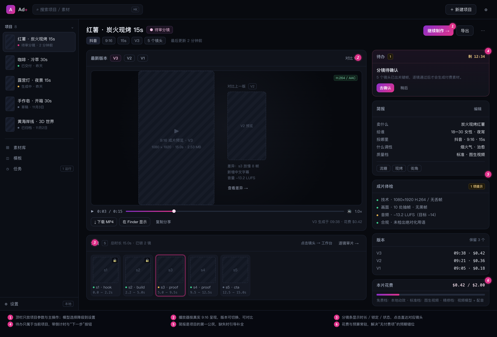
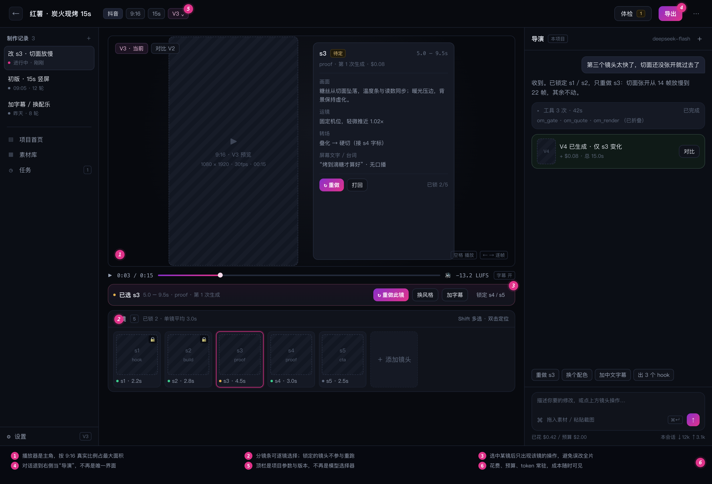
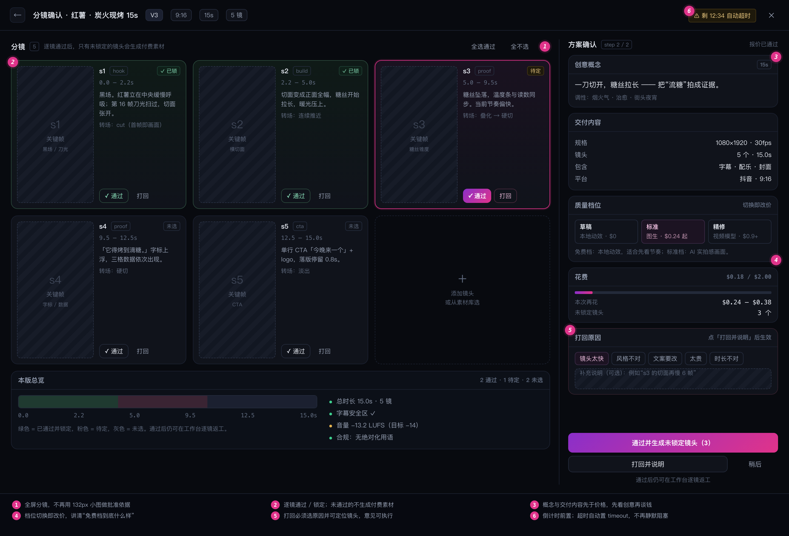

# Ad+ 产品需求文档 v2

**从「Agent 工作台」到「广告片生产台」**

> **交互层已被 [v3 交互重设计](interaction-redesign-v3.md) 修订**：三屏收敛为一屏三态（画布 / 分镜 / 审片），简报改为起始卡，报价与分镜默认合并为一次方案审阅。数据模型、接口、审批记录仍以本文为准；§5 / §7 中涉及页面与导航的部分以 v3 为准。

| 项 | 内容 |
|---|---|
| 版本 | v2.0-draft |
| 日期 | 2026-11-05 |
| 状态 | 待评审 |
| 范围 | P0（约 3.5 周；两周最小集见 §11.1）+ P1 概要 |
| 配套线框 | [01 项目首页](wireframes/01-project-home.html) · [02 工作台](wireframes/02-workspace.html) · [03 审批中心](wireframes/03-approval.html) · [线框索引](wireframes/index.html) |
| 代码基线 | `frontend/` Solid SPA · `app/settings_server.py` · `adplus/mcp/__main__.py` |

---

## 0. 摘要

当前 Ad+ 已经能跑通「一句话 → 报价 → 分镜 → 渲染 → 成片」，但界面只有**一个聊天窗口 + 一个缩略图侧栏**。真正决定广告质量的领域对象——简报、创意概念、分镜、镜头、版本、审片结论——全部以 JSON 形式躺在 `projects/<id>/` 里，用户看不见、改不动、也带不走。

本 PRD 的目标不是加功能，而是**把这些对象变成界面**，让主流程闭环：

```
新建项目 → 填简报（5 项） → 报价/方案确认 → 分镜逐镜确认 → 生成
        → 工作台看片/逐镜返工 → 成片体检 → 导出交付
```

P0 的成功标准只有一句：**一个新用户不写 prompt，只填一张 5 行的简报，就能在 10 分钟内拿到一条可下载的 15 秒竖屏广告，并且中途能看懂每一步在做什么、花了多少钱。**

---

## 1. 背景与问题

### 1.1 现状证据

| 现象 | 代码/界面证据 | 影响 |
|---|---|---|
| 用户不知道该说什么 | 输入框只有一句 placeholder；时长/比例/平台/配音无法表达 | 首轮对话反复澄清，返工率高 |
| 报价看不见方案 | `AskDock` 只渲染 `line_items` 与 `assumptions`；无关键帧、无概念 | 用户在“没看到东西”的情况下批准付费 |
| 分镜无法判断 | 预览图 132px 高横向滚动（`AskDock.tsx`） | “第二个镜头太快”这类意见只能靠文字猜 |
| 成片无法局部改 | 唯一杠杆是再发一条聊天 | 改一镜 = 全片重跑，成本高、迭代少、质量停在首版 |
| 高质量数据被埋没 | `scene_plan.json` 有景别/运动/转场/安全边距；`final_review.json` 有技术/画面/音频体检与“最弱的一刻” | 这些正是分镜台与审片页的核心数据，界面零呈现 |
| 没有项目/版本 | `Rail.tsx` 只有会话；4 条同名“做一条 15 秒竖屏广告” | 不能接单、不能复用、不能交付 |
| 审批不分区 | `stores/asks.ts` 全局拉取，无 `project_id` 过滤 | A 项目的报价会弹在 B 会话里 |
| 失败无解释 | `JobsPanel` 不渲染 `job.error`，无重试 | 用户卡死，只能重开对话 |
| 产物不可交付 | 只有预览；`/api/reveal`、`/api/trash` 已存在但 UI 未接 | 找不到文件、发不出去 |
| 流水线消失 | `/api/workspace` 有阶段数据，SPA 未调用 | 用户不知道进行到哪一步 |
| 上传回归 | 文档 §2.10 写了拖拽/粘贴，`Composer.tsx` 无对应 handler | 素材入口退化 |

### 1.2 根因

1. **输入侧**：自然语言是唯一入口，结构化参数没有位置。
2. **中间侧**：过程产物没有视图，用户只能看到“工具调用成功”。
3. **输出侧**：没有项目与版本，产物是一次性的聊天附件。

---

## 2. 目标与非目标

### 2.1 目标（P0）

| # | 目标 | 衡量 |
|---|---|---|
| G1 | 新用户无需 prompt 工程即可开工 | 完成简报 → 首次可播放 ≤ 10 分钟（本地档） |
| G2 | 用户在花钱前看得见方案 | 报价卡含概念 + ≥3 张关键帧；报价通过率 ≥ 60% |
| G3 | 用户能局部修改而非全片重跑 | 单项目平均重做镜头数 ≤ 2.5；全片重跑率下降 50% |
| G4 | 用户能拿到可交付文件 | 导出成功率 ≥ 95%；导出率 ≥ 50% |
| G5 | 用户知道每一步在做什么、花了多少 | 任务失败 100% 有原因与重试；花费常驻可见 |
| G6 | 项目可被找回与复用 | 会话/项目可重命名、搜索、删除；7 日回访 ≥ 30% |

### 2.2 非目标（P0 明确不做）

- 云端协作、多租户、团队权限
- 模板市场 / 创作者分成
- 移动端
- 实时协同编辑
- 自动投放（接抖音/巨量 API）

> 原则：先把“一个人做一条片”的闭环做顺，再谈规模化。

---

## 3. 用户与核心任务

| 角色 | 典型场景 | 最在意 | 当前卡点 |
|---|---|---|---|
| **小店老板**（非专业） | 今晚要发一条红薯促销 | 快、便宜、别让我想 prompt | 不知道怎么写、看不懂“450 帧” |
| **投放/运营** | 一次出 3 个 hook 做 A/B | 版本对比、平台规格、合规 | 没有版本、没有变体、没有规格护栏 |
| **小工作室/剪辑师** | 客户改第 3 镜、换 BGM、加字幕 | 局部修改、交付包、审片意见 | 改一镜要全片重跑，意见只能打字 |

### 3.1 Jobs to be done

- 当我有一个产品要卖时，我想在 10 分钟内得到一条能直接投放的竖屏视频。
- 当我不满意某个镜头时，我想只改那一镜，而不是重做整条。
- 当客户说“通过”时，我想把成片、封面、字幕打包发给他。
- 当我要投不同平台时，我想一次拿到对应比例与规格的版本。

---

## 4. 主线流程与状态机

### 4.1 主流程

```
① 新建项目（选模板或空白）
      ↓
② 简报 Brief（卖什么/给谁/投哪里/多长/什么调性）—— 可跳过，跳过则用默认值
      ↓
③ 报价 + 方案确认（概念、关键帧、分镜节奏、价格、档位）
      ↓ 用户批准
④ 生成分镜（scene_plan）→ 分镜闸门（逐镜通过/锁定）
      ↓ 用户批准
⑤ 生成素材与渲染（只跑未锁定的镜头）
      ↓
⑥ 工作台看片 → 逐镜返工（重做 s3 / 换配色 / 加字幕）
      ↓
⑦ 成片体检（技术/画面/音频/字幕/合规）
      ↓
⑧ 导出交付（平台预设 + 封面 + SRT）
```

### 4.2 项目状态

| 状态 | 进入条件 | 允许操作 | 出口 |
|---|---|---|---|
| `draft` | 新建 | 填简报、删除 | → `briefing` |
| `briefing` | 打开简报 | 保存、跳过 | → `quoted` |
| `quoted` | 已出报价 | 批准/打回 | 批准 → `storyboard`；打回 → `briefing` |
| `storyboard` | 分镜待审 | 逐镜通过/打回 | 通过 → `producing` |
| `producing` | 生成中 | 取消、查看进度 | → `review` |
| `review` | 有可播放成片 | 逐镜返工、导出 | → `delivered` / 回到 `producing` |
| `delivered` | 已导出 | 复制项目、再出一版 | → `producing` |
| `archived` | 手动归档 | 恢复、删除 | — |

### 4.3 审批状态（quote / gate 共用）

```
pending ──approve──→ approved
   │
   ├──reject(reasons + comment)──→ rejected ──agent 返工──→ 新 pending
   ├──timeout（默认 15 分钟）──→ timeout（agent 停止并提示）
   └──superseded（用户改了简报/版本）──→ superseded
```

规则：
- 审批**必须绑定 `project_id` + `version_id`**，UI 只展示当前项目的待办。
- 超时前 2 分钟在卡片上显示倒计时；应用不在前台时发系统通知。
- 拒绝必须至少选 1 个原因 chip（可加自由文本），原因回传给 agent。

---

## 5. 信息架构与路由

```
/                         项目首页（有项目→最近项目；无项目→新建引导）
/projects/:id             项目首页（单项目）
/projects/:id/workspace   工作台（画布 + 导演对话）
/projects/:id/approvals   审批中心（全屏）
/projects/:id/review      成片体检（可嵌入审批/工作台）
/library                  素材库（P1）
/tasks                    任务中心（P0 简化版）
/settings                 设置（模型/媒体 key/品牌/关于）
/onboarding               首次配置（模型）
```

导航原则：
- **左栏是项目，不是会话**；会话挂在项目内（工作台右侧可切换“制作记录”）。
- 顶栏只放项目参数（平台/比例/时长/版本）+ 主操作（导出），**模型选择移到设置**。
- 全局唯一“待办”入口：左栏底部红点 + 项目首页顶部的待办卡。

---

## 6. 数据模型

> 存储仍遵循“文件系统即契约”。所有写入沿用 `tmp + os.replace` 原子替换。
> 旧项目（只有 `project.json` 1.0）读取时自动补默认值，不迁移、不阻塞。

### 6.1 Project（`projects/<id>/project.json` v2）

| 字段 | 类型 | 必填 | 说明 |
|---|---|---|---|
| `version` | string | 是 | `"2.0"` |
| `project_id` | string | 是 | kebab-case，目录名 |
| `title` | string | 是 | 用户可改，默认取简报产品名 + 时长 |
| `status` | enum | 是 | 见 §4.2 |
| `pipeline_type` | string | 是 | 沿用上游（cinematic / animation / talking-head …） |
| `platform` | enum | 是 | `douyin` / `xiaohongshu` / `wechat_channels` / `shorts` / `meta` / `generic` |
| `aspect` | enum | 是 | `9:16` / `1:1` / `16:9` / `4:5`，默认由 platform 推导 |
| `duration_s` | number | 是 | 6/15/30/60，可自定义 3–120 |
| `quality_tier` | enum | 是 | `draft`（本地动效）/ `standard`（图生视频）/ `premium`（视频模型+配音） |
| `brand_id` | string? | 否 | 关联品牌包 |
| `brief` | object | 否 | 见 §6.2；缺失时项目首页显示“补全简报” |
| `current_version_id` | string? | 否 | 默认最新版本 |
| `cover` | string? | 否 | 封面图相对路径 |
| `created_at` / `updated_at` | ISO8601 | 是 | |

### 6.2 Brief

| 字段 | 类型 | 必填 | 默认 | UI 控件 |
|---|---|---|---|---|
| `product` | string | 是 | — | 单行输入 |
| `audience` | string | 否 | “泛人群” | 单行 + 常用标签 |
| `platform` | enum | 是 | `douyin` | 平台选择卡（图标） |
| `duration_s` | number | 是 | 15 | 6/15/30/60 分段 |
| `tone` | string[] | 否 | `["烟火气"]` | 多选 chips + 自定义 |
| `selling_points` | string[] | 否 | `[]` | 最多 3 条 |
| `cta` | string | 否 | 平台默认 | 单行 |
| `references` | string[] | 否 | `[]` | 拖拽/选择图片、视频 |
| `constraints` | object | 否 | `{}` | 禁用词、必须出现 logo/价格 |

### 6.3 Version（`versions/<id>.json`）

| 字段 | 类型 | 说明 |
|---|---|---|
| `id` / `label` | string | `v3` / `V3` |
| `parent_id` | string? | 来源版本，用于对比与回滚 |
| `status` | enum | `producing` / `review` / `approved` / `superseded` |
| `render` | object | `{path, poster, width, height, fps, bytes, duration_s}` |
| `shots` | Shot[] | 见 §6.4，顺序即播放顺序 |
| `cost_usd` | number | 本版本累计生成成本 |
| `review` | object? | 见 §6.6 |
| `created_at` | ISO8601 | |

### 6.4 Shot

| 字段 | 类型 | 说明 |
|---|---|---|
| `id` | string | `s1`…；跨版本保持稳定，便于“只重做 s3” |
| `index` | number | 从 1 开始 |
| `start_s` / `end_s` | number | 时间轴 |
| `role` | enum | `hook` / `build` / `proof` / `cta` |
| `description` | string | 画面描述（来自 scene_plan） |
| `framing` | string | 景别/构图/安全边距 |
| `movement` | string | 运镜 |
| `transition_in` / `transition_out` | string | 转场 |
| `on_screen_text` | string | 屏幕文字/字幕 |
| `narration` | string | 口播 |
| `status` | enum | `planned` / `generating` / `ready` / `approved` / `needs_rework` |
| `locked` | bool | 锁定后不参与重跑 |
| `preview` | string? | 关键帧/预览图 |
| `take_count` | number | 已生成次数 |
| `cost_usd` | number | 该镜累计成本 |

### 6.5 Quote（扩展现有 `quotes/<id>.json`）

新增字段：

| 字段 | 类型 | 说明 |
|---|---|---|
| `version_id` | string | 对应版本 |
| `concept` | string | 一句话创意概念（≤ 40 字） |
| `tier` | enum | 本次报价对应的质量档 |
| `platform` / `aspect` / `duration_s` | — | 回显，避免“报的和做的不是一条” |
| `shots_preview` | string[] | 3–5 张关键帧/分镜草图 |
| `free_preview` | object | `{label, usd:0, note}` 展示“免费档会是什么样” |
| `expires_at` | ISO8601 | 默认 created_at + 15 分钟 |
| `reasons` | string[] | 用户拒绝时选的原因 |

现有 `line_items` 的 `label` 必须说人话：`"5 个镜头 · 图生视频"`，禁止 `"渲染 450 帧"` 单独出现（帧数放 `detail`）。

### 6.6 Review（`reviews/<version_id>.json`，由 `artifacts/final_review.json` 归一化）

| 字段 | 类型 | 说明 |
|---|---|---|
| `checks` | `{name, verdict, detail}[]` | 技术/画面/音频/字幕/合规，verdict ∈ pass / warn / fail |
| `weak_moments` | `{start_s, end_s, shot_id, note}[]` | 直接跳转到时间点 |
| `recommended_action` | enum | `present_to_user` / `fix` / `regenerate` |

### 6.7 Deliverable（`deliverables/<id>.json`）

`{id, version_id, preset, path, cover, srt, bytes, width, height, created_at}`

---

## 7. P0 界面规格

> 三个界面分别对应 `wireframes/01|02|03`。以下“字段”指界面上必须出现的值，不做装饰性展示。
>
> 线框为 1440×980 的桌面窗口；图为真实渲染，不是手绘。

### 7.1 项目首页 `/projects/:id`



**目标**：用户 3 秒内知道“这条片子在哪一步、下一步点哪里”。

```
┌──────────────────────────────────────────────────────────────────────────────┐
│ ◐ Ad+   🔍 搜索项目 ⌘K                              [+ 新建项目]   ⚙         │
├───────────────┬──────────────────────────────────────────────────────────────┤
│ 项目           │  红薯 · 炭火现烤 15s   [待审分镜]      [继续制作] [导出] [⋯] │
│ ▸ 红薯 15s ●   │  douyin · 9:16 · 15s · V3                                    │
│ ▸ 咖啡 30s     │ ┌───────────────────────┐ ┌───────────────────────────────┐ │
│ ▸ 旧项目…      │ │      ▶ 9:16 播放器     │ │ ⏰ 待办 1                     │ │
│               │ │      V3 V2 V1         │ │ 分镜待确认 · 剩 12:34  [去确认]│ │
│ 素材库         │ │  [下载] [Finder] [⋯]  │ ├───────────────────────────────┤ │
│ 模板           │ └───────────────────────┘ │ 简报  产品/人群/平台/时长/调性 │ │
│ 任务           │ 分镜 5 镜  ▸ s1 ▸ s2 ▸ s3 │       [编辑]                  │ │
│               │ ┌────┐┌────┐┌────┐┌────┐  ├───────────────────────────────┤ │
│               │ │ s1 ││ s2 ││ s3 ││ s4 │  │ 成片体检  ✓ 技术 ✓ 画面 ⚠ 音频 │ │
│               │ └────┘└────┘└────┘└────┘  ├───────────────────────────────┤ │
│               │                           │ 版本 V3 当前 · V2 · V1        │ │
│               │                           │ 本片花费 $0.42 / 预算 $2.00    │ │
└───────────────┴──────────────────────────────────────────────────────────────┘
```

**区域规格**

| 区域 | 元素 | 数据 | 交互 |
|---|---|---|---|
| A 顶栏 | 搜索、新建、设置 | — | ⌘K 打开项目搜索；新建进入简报 |
| B 左栏 | 项目列表 | `project_id,title,cover,status,updated` | 点击切换；右键重命名/复制/归档/删除 |
| C 头部 | 标题、状态、参数、主操作 | `title,status,platform,aspect,duration,current_version` | 标题就地编辑；“继续制作”按状态跳转（briefing→简报，storyboard→审批，producing→工作台，review→体检） |
| D 播放器 | 视频/封面、版本 tabs、下载/Finder | `versions[].render` | 切版本换片；空格播放；下载走浏览器 |
| E 分镜条 | 每镜缩略图 + 状态点 + 锁 | `shots[]` | 点击进入工作台并定位该镜 |
| F 待办卡 | 类型、stage、倒计时、CTA | `pending[]` | 点击打开审批中心；超时后变为“已超时，重新发起” |
| G 简报卡 | 5 项摘要 | `brief` | 编辑打开侧滑表单；缺失显示“补全简报” |
| H 体检卡 | 3–5 项 verdict | `review.checks` | 点击进入体检详情 |
| I 版本/花费 | 版本列表、花费/预算 | `versions[],cost_usd,budget_usd` | 版本对比（P1）；花费点击看明细 |

**状态**
- 空（无项目）：三张入口卡“从模板开始 / 上传素材 / 从零描述”+ 一个示例项目。
- 加载：播放器与列表骨架屏，不出现空白。
- 失败：项目读取失败显示原因 + 重试 + 打开目录。
- 无成片：播放器位置显示首帧分镜拼图 + “开始生成”。

**验收**
1. 从任意状态进入项目，头部主按钮文案与目标页正确（状态机映射表驱动）。
2. 待办卡只出现当前项目的待办。
3. 分镜条点击能定位到工作台对应镜头。
4. 版本切换后播放器与分镜条同步更新。
5. 旧项目（v1 json）打开不报错，显示“补全简报”。

---

### 7.2 工作台 `/projects/:id/workspace`



**目标**：看片与改片在同一个屏幕完成；聊天是“导演”，不是主界面。

**聊天没有被废弃。** 消息流、Markdown、流式输出、工具时间线、中断、附件、会话恢复、模型切换全部保留；改变的是位置与权重：从“唯一主界面”变成与画布并列的“导演侧栏”，并支持 `⌘\` 展开到 50% / 全屏。审批不再内联成 132px 卡片，而是紧凑待办条 + 全屏审批中心。去留映射见 [附录 B](#附录-b现有聊天界面的去留)。

```
┌──────────────────────────────────────────────────────────────────────────────┐
│ ← 红薯 15s        douyin · 9:16 · 15s · [V3 ▾]            [导出] [体检]      │
├──────┬───────────────────────────────────────────────┬───────────────────────┤
│ 项目  │              ┌───────────────┐              │ 导演        [模型 ▾]  │
│      │              │               │              │ ─────────────────────  │
│ 记录  │              │   9:16 播放    │              │ 你说：第三个镜头太快   │
│ · 初版│              │               │              │ 导演：已锁定 1/2/4/5，  │
│ · 改s3│              │               │              │      只重做 s3…        │
│ · 加字幕             └───────────────┘              │ ┌ 工具 3 次 · 42s ┐   │
│      │   ▶ 0:03 / 0:15   🔊  ─────●────             │ └─────────────────┘   │
│      │ ┌──────┐┌──────┐┌──────┐┌──────┐┌──────┐   │ [重做 s3][换配色]     │
│      │ │ s1 🔒││ s2 🔒││ s3 ⚠ ││ s4 🔒││ s5 🔒│   │ [加字幕][出3个hook]   │
│      │ │ 2.2s ││ 2.8s ││ 4.5s ││ 3.0s ││ 2.5s │   │ ─────────────────────  │
│      │ └──────┘└──────┘└──────┘└──────┘└──────┘   │ [输入指令…        ➤]  │
│      │  ↑ 点选镜头 → 只对这一镜操作                  │ 已花 $0.42 / 预算 $2  │
└──────┴───────────────────────────────────────────────┴───────────────────────┘
```

**区域规格**

| 区域 | 元素 | 数据 | 交互 |
|---|---|---|---|
| A 顶栏 | 返回、项目名、参数、版本、导出、体检 | `project.*` | 版本切换；导出打开展示预设弹层 |
| B 左栏（窄） | 制作记录（本项目会话） | `sessions[]` | 切换会话；新建“制作记录” |
| C 播放器 | 视频、时间轴、音量 | `version.render` | 空格播放；←/→ ±1s；点击画面暂停 |
| C2 镜头检查器 | 选中镜的画面/运镜/转场/字幕/台词/成本 | `shots[selected]` | 不用翻聊天就能判断这一镜；重做/打回入口 |
| D 分镜条 | 5 张 9:16 缩略图 + 时长 + 锁 + 状态 | `shots[]` | 单选/多选；🔒 切换锁定；双击定位时间点 |
| E 镜头操作条 | 重做此镜、换风格、加字幕、导出该镜 | `shot.*` | 重做 → 发结构化指令（见下） |
| F 导演对话 | 消息、工具时间线、快捷 chips | `transcript` | 同现有聊天；工具折叠保留 |
| G 底栏 | 输入框、附件、花费 | `cost/budget` | 拖拽/粘贴恢复；⌘Enter 发送 |

**逐镜返工（P0 实现方式）**

点击“重做 s3”时：

1. 前端把 s1/s2/s4/s5 标记为锁定（UI 立即反馈），s3 置 `needs_rework`。
2. 发送结构化指令：

```
【只重做 s3，其余镜头已锁定，不要改动】
项目 sweet-potato-15s / V3
镜头 s3：5.0–9.5s，proof，现描述：…
我的要求：<用户在弹层里填/选>
约束：保持品牌色 #8B2FC9、字幕安全区、总时长 15s
```

3. agent 只重跑 s3，完成后写回 `versions/<id>.json` 的 `shots[]`，生成 V4。
4. 前端收到 `version` 事件后切到 V4，并保留 V3 供对比。

> P1 再收成 `om_reroll_shot` 工具；P0 用指令 + 锁定标记即可，不阻塞。

**空/异常**
- 无成片：显示分镜拼图 + “生成第一版”。
- 生成中：分镜条对应镜头显示进度；任务失败在条上标红，点击展开原因 + 重试。
- 断线：顶部黄条“已断开，重连中”，不丢输入草稿（localStorage）。

**验收**
1. 点镜头只选中一镜，其他镜头操作条不出现。
2. 重做 s3 后，V4 只变 s3；V3 仍可切回。
3. 失败任务在分镜条上可见原因，点击可重试。
4. 顶栏不再出现模型选择；模型在设置里。
5. 1440×900 下播放器默认 ≥260×460；⌘\ 收起对话后 ≥420×746。

---

### 7.3 审批中心 `/projects/:id/approvals`



> 线框展示“分镜确认”模式；“报价确认”复用同一外壳：左侧换成概念与 3–5 张关键帧，右侧增加档位与价格明细。

**目标**：让“批准”建立在看得见的方案上；让“打回”是可执行的，而不是一句抱怨。

采用**全屏抽屉**而不是输入框上方的卡片，因为分镜需要占屏。两种模式共用外壳：

```
┌──────────────────────────────────────────────────────────────────────────────┐
│ 分镜确认 · 红薯 15s                        V3 · 9:16 · 15s      剩 12:34  ✕  │
├───────────────────────────────────────────────────────┬──────────────────────┤
│  ┌─────────┐ ┌─────────┐ ┌─────────┐                 │ 创意概念              │
│  │  s1     │ │  s2     │ │  s3     │                 │ “一刀切开，糖丝拉长”  │
│  │ 0.0-2.2 │ │ 2.2-5.0 │ │ 5.0-9.5 │                 │ ──────────────────── │
│  │ hook    │ │ build   │ │ proof   │                 │ 交付内容              │
│  │ ✓ 锁    │ │ ✓ 锁    │ │ ⚠ 待定  │                 │ 5 镜 · 15s · 9:16     │
│  └─────────┘ └─────────┘ └─────────┘                 │ 1080×1920 · 30fps    │
│  ┌─────────┐ ┌─────────┐                             │ 字幕 · 配乐 · 封面    │
│  │  s4     │ │  s5     │   ← 逐镜：通过 / 打回 / 锁  │ ──────────────────── │
│  │ 9.5-12.5│ │12.5-15.0│                             │ 花费                  │
│  │ proof   │ │ cta     │                             │ 已花 $0.18 / 上限 $2 │
│  └─────────┘ └─────────┘                             │ 本次再花 $0.24–0.38  │
│                                                       │ ──────────────────── │
│  总时长 15.0s ✓   字幕安全区 ✓   音量 -14 LUFS ✓     │ [通过，开始生成]      │
│  合规：未检出绝对化用语 ✓                             │ [打回，选原因]        │
└───────────────────────────────────────────────────────┴──────────────────────┘
```

**模式 A：报价确认（生成前）**

- 左：概念关键词 + 3–5 张关键帧/草图；没有图时用“分镜节奏条”（每镜色块 + 时长 + 一句话）。
- 右：概念、交付内容、**质量档位选择器**（草稿/标准/精修，切换即改价）、逐项报价、总价区间、ETA、假设。
- 必须显示“免费档会是什么样”与“付费档多什么”，解决“无付费项”带来的预期错位。
- 主按钮：`通过，开始生成`；次按钮：`改方案`（结构化字段：时长/比例/档位/风格/镜头数）。

**模式 B：分镜确认（生成付费素材前）**

- 左：分镜网格，每镜含关键帧、时长、role、画面描述、转场；可逐镜勾选“通过并锁定”。
- 右：整体信息 + 检查项（时长/安全区/音量/合规）+ 花费 + 决策。
- 主按钮：`通过并生成未锁定镜头`；次按钮：`打回`。

**打回面板**

原因 chips（可多选）：`镜头太快` `风格不对` `文案要改` `镜头太多/太少` `太贵` `时长不对` `其他`。选中后可选到具体镜头（`s3`），再补自由文本。

**字段**

| 字段 | 来源 | 必现 |
|---|---|---|
| concept | quote.concept | 是 |
| tier | quote.tier | 是 |
| platform/aspect/duration | quote | 是 |
| shots[] 预览 | quote.shots_preview 或 approval.previews | 是 |
| line_items（人话） | quote.line_items | 是 |
| total/low/high/eta | quote | 是 |
| assumptions | quote.assumptions | 是（可折叠） |
| 检查项 | approval.checks | 是 |
| 已花/上限 | approval.spent_usd / budget_usd | 是 |
| 倒计时 | expires_at | 是 |

**状态**
- 无预览图：显示“正在生成关键帧…”占位，不阻塞批准但主按钮文案改为“通过，先生成分镜”。
- 超时：卡片变灰，“已超时 — 重新发起”按钮（重新走 om_quote / om_gate）。
- 已被新版本取代：显示“此报价已过期”，只读。

**验收**
1. 批准前用户至少看到 3 张画面或完整分镜网格。
2. 切换质量档位，价格与“包含内容”同步变化。
3. 打回必须选原因，原因写入 `decision.reasons` 并回传 agent。
4. 逐镜通过后，未通过的镜头有明确标记；生成的镜头集合与标记一致。
5. 倒计时结束自动置 timeout，UI 不再可点“通过”。

---

### 7.4 任务中心与导出（P0 简版）

**任务中心** `/tasks`：跨项目列表，字段 `项目 / 类型 / 镜头 / 状态 / 进度 / 耗时 / 花费 / 错误`。
- 失败行展开显示 `job.error` 原文 + “重试 / 打开日志 / 复制错误”。
- 运行中可取消；取消需确认。
- 桌面通知：任务完成/失败、审批待办。

**导出**（弹层，不跳页）：
- 预设：抖音 1080×1920 / 视频号 1080×1920 / 小红书 1080×1440 / Shorts 1080×1920 / 通用 MP4。
- 选项：封面帧（首帧/自定义/上传）、字幕 SRT、去水印、命名模板 `{项目}-{版本}-{平台}-{日期}`。
- 完成后：下载、在 Finder 显示、复制审片链接（P2）。

---

## 8. 交互规则

| 场景 | 规则 |
|---|---|
| 审批作用域 | 所有待办按 `project_id` 过滤；左侧红点显示当前项目数量 |
| 通知 | 应用后台时，审批/完成/失败发系统通知；点击唤回对应项目 |
| 超时 | 15 分钟；剩 2 分钟卡片变黄；超时后 agent 必须停止并输出“等待下一步” |
| 破坏性操作 | 删除项目/版本/产物二次确认；删除进废纸篓，可撤销 10 秒 |
| 加载 | 任何 >300ms 的读取用骨架屏；禁止空白 |
| 错误 | 人话 + 原因 + 重试 + “复制详情”；不显示裸 stack |
| 键盘 | ⌘K 搜索、⌘Enter 发送、⌘\ 收起对话、空格播放/暂停、←/→ ±1s、Esc 关层 |
| 草稿 | 输入框内容按项目存 localStorage，刷新/切页不丢 |
| 上传 | 拖拽到窗口任意位置、粘贴图片/视频、文件选择三入口；显示上传进度与失败原因 |
| 空态 | 每个空态给“下一步做什么”，不给抒情文案 |

---

## 9. 接口与存储变更

### 9.1 新增

| 方法 | 路径 | 用途 |
|---|---|---|
| GET | `/api/projects` | 列表（含 cover/status/platform/updated） |
| POST | `/api/projects` | 从简报创建项目 |
| GET | `/api/projects/{id}` | 项目详情 + 版本 + 分镜 + 待办 + 体检 |
| PATCH | `/api/projects/{id}` | 改标题/简报/状态/归档 |
| DELETE | `/api/projects/{id}` | 进废纸篓 |
| GET/POST | `/api/brands`、`/api/brands/{id}` | 品牌包（P1，读接口先留） |
| GET | `/api/versions?project_id=` | 版本列表 |
| POST | `/api/versions/{id}/promote` | 设为当前 |
| POST | `/api/export` | `{version_id, preset, options}` → deliverable |
| GET | `/api/deliverables?project_id=` | 交付物列表 |
| POST | `/api/jobs/{id}/retry` | 重试失败任务 |
| PATCH/DELETE | `/api/sessions/{id}` | 重命名/删除会话 |

### 9.2 修改

| 端点 | 变更 |
|---|---|
| `GET /api/quotes`、`/api/approvals` | 支持 `project_id` 必传过滤；返回新增字段 |
| `POST /api/quotes/{id}`、`/api/approvals/{id}` | body 增加 `reasons[]`、`shots[{id,approved,locked,comment}]` |
| `GET /api/jobs` | 返回 `error`、`shot_id`、`cost_usd` |
| `GET /api/artifacts` | 返回 `width/height/duration_s/poster`（一次性 ffprobe 并缓存） |
| `GET /api/workspace` | 保留，供项目首页阶段条；SPA 接上 |
| `POST /api/upload` | 支持 `project_id`，落到项目 assets；返回 asset id |

### 9.3 MCP / agent 契约

| 工具 | 变更 |
|---|---|
| `om_start_project` | 增加 `platform/aspect/duration_s/brief/brand_id/quality_tier`，写入 project.json v2 |
| `om_quote` | 增加 `concept`、`previews`、`tier`、`expires_at`；line item label 必须人话 |
| `om_gate` | 增加 `version_id`、`shots[]`、`checks[]`、`spent_usd/budget_usd` |
| `om_artifacts` | 返回相对路径 + kind + 尺寸（供 UI 直接渲染） |
| 系统提示 | 报价必须先给概念 + 3 张关键帧；付费镜头生成前必须过 storyboard gate；锁定镜头不得重跑 |

### 9.4 存储布局

```
projects/<id>/
  project.json            # v2
  versions/v1.json ...
  previews/v3/s1.jpg ...
  reviews/v3.json
  deliverables/<id>.json
  quotes/*.json           # 扩展
  approvals/*.json        # 扩展
  renders/*.mp4
  assets/*                # 项目素材
```

兼容：读取 v1 `project.json` 时补 `status=draft`、`platform=generic`、`aspect=9:16`、`duration_s=15`、`quality_tier=standard`。

---

## 10. 埋点与指标

| 事件 | 触发 | 关键属性 |
|---|---|---|
| `project_created` | 创建项目 | source(template/upload/blank), platform |
| `brief_completed` | 保存简报 | filled_fields, skipped |
| `quote_shown` | 报价出现 | tier, total_usd, has_previews |
| `quote_decided` | 批准/打回 | approved, reasons[], seconds_to_decide |
| `storyboard_shown` | 分镜闸门 | shots, previews |
| `storyboard_decided` | 逐镜决策 | approved_shots, rejected_shots, reasons |
| `shot_reroll` | 点重做 | shot_id, take_count |
| `render_finished` | 渲染结束 | ok, duration, cost_usd, error_code |
| `review_result` | 体检 | verdicts, weak_moments |
| `export_done` | 导出 | preset, bytes |
| `approval_timeout` | 超时 | stage |

**北极星**：每周“被导出的成片数”。

**质量/效率仪表**：TTFV（首次可播放）、首版接受率、单项目返工镜头数、单条被接受广告成本、审批通过率、超时率、导出率、D7 回访。

---

## 11. P0 排期与验收

以 1 人全职计，约 17 人日（3.5 周）。表中 2–7 在接口定型后可并行；若只有 2 周，按 §11.1 的最小集砍。

| # | 工作项 | 估时 | 依赖 | 验收 |
|---|---|---|---|---|
| 1 | 数据模型 v2 + 读取兼容 + `/api/projects/{id}` | 2.5d | — | 旧项目可打开；详情一次返回所需数据 |
| 2 | 项目首页（列表/头部/播放器/分镜条/待办/简报） | 3d | 1 | §7.1 验收全过 |
| 3 | 工作台重构（播放器 + 分镜条 + 导演侧栏） | 3.5d | 1 | §7.2 验收全过 |
| 4 | 审批中心（报价/分镜/打回原因/倒计时） | 3d | 1 | §7.3 验收全过 |
| 5 | 任务中心 + 失败原因/重试 + 导出 | 2d | 1 | 失败可见可重试；导出可下载 |
| 6 | 会话重命名/删除/搜索 + 审批作用域 + 上传拖拽/粘贴恢复 | 1d | — | 回归清单全过 |
| 7 | 埋点 + 指标面板（内部） | 0.5d | 2–5 | 事件可查 |
| 8 | 联调与真机验证（Tauri 窗口 1440/1280） | 1.5d | 全部 | 无阻塞缺陷 |

### 11.1 两周最小集（如果只有 10 天）

只做 1（数据/接口 2.5d）、4（审批中心 3d）、2（项目首页 3d）、6（回归修复 1d），合计 9.5d，留 0.5d 缓冲。
工作台只做“播放器 + 分镜条 + 现有聊天”的改造，不做完整重构。

这样仍然闭环：新建 → 简报 → 报价带方案 → 分镜逐镜确认 → 看片 → 导出。
**“报价带方案 + 分镜逐镜确认”是信任与质量的核心**，工作台美化可以后置。

### 11.2 P0 完成定义（DoD）

- 新用户从 `/` 出发，只用简报 + 两次批准，得到一条可播放、可下载的 15s 竖屏 MP4。
- 任一失败步骤都有原因与重试。
- 所有审批只出现在所属项目内。
- 1440×900 与 1280×800 下无横向滚动、无遮挡。
- 不新增必须配置的 key；默认仍可本地出片。

---

## 12. 风险、兼容与待定

| 风险 | 影响 | 应对 |
|---|---|---|
| agent 仍按老习惯只报价不给方案 | 报价卡无内容 | 改系统提示 + 后端在无 `concept` 时显示“方案生成中”，并允许“先看分镜再报价” |
| 逐镜锁定与 agent 行为不一致 | 改了不该改的镜头 | 指令里显式列出锁定镜头；完成后校验 `shots[].id` 未变，否则回滚并提示 |
| 审批 15 分钟超时 | agent 阻塞 | 超时前通知；超时后 agent 输出摘要并停止，不自动继续 |
| 旧项目数据缺失 | 打开报错 | 读取层兜底默认值，UI 显示“补全简报” |
| WKWebView 视频编码 | 部分成片不能播 | 导出统一 H.264/AAC；预览失败给“用系统播放器打开” |
| 项目很多时列表卡 | 首屏慢 | 分页 + 封面缩略图懒加载 |
| 本地磁盘占用 | 用户无感增长 | 项目页显示占用，提供“清理中间产物” |

### 待定问题

1. 质量档位的具体供应商与价格区间，需要一次真实跑量校准。
2. 品牌包是否进 P0？（建议 P1，但项目页先留 `brand_id` 字段）
3. 是否需要“客户审片链接”作为 P0 的差异化？（建议 P2）
4. 模板内容由谁生产：内置 5 个足够，还是要做模板市场？
5. 中文之外的语言（英/日/东南亚）是否进入下一版？

---

## 附录 A：P0 回归清单（当前已知问题）

- [ ] 任务失败渲染 `job.error` + 重试
- [ ] 产物下载 / 在 Finder 显示 / 删除
- [ ] 拖拽、粘贴上传恢复
- [ ] 审批按项目过滤
- [ ] 流水线阶段条接回 `/api/workspace`
- [ ] 会话重命名 / 删除 / 搜索
- [ ] 报价文案去工程化（帧数、文件大小）
- [ ] 分镜/体检 JSON 结构化展示，不再只给文件名
- [ ] 空态给模板与示例
- [ ] 模型选择移入设置

---

## 附录 B：现有聊天界面的去留

**结论：能力全部保留，只改位置和权重。** 这次改版不是把聊天换成表单，而是给“看得见的对象”（项目、分镜、版本、审批）补上界面；聊天仍然是并列的一等入口。

| 现在 | PRD 之后 | 状态 |
|---|---|---|
| 左栏 = 会话列表 | 左栏 = 项目列表；会话变成项目内的“制作记录” | 移动 |
| 中央 = 聊天主界面 | 中央 = 画布（播放器 + 分镜条 + 检查器）；聊天在右栏 | 重排 |
| 顶栏 = 模型胶囊 | 顶栏 = 项目参数与版本；模型在设置 / 导演头部 | 移动 |
| 消息流、Markdown、流式光标 | 原样 | **保留** |
| 工具时间线（折叠、耗时、错误态） | 原样，默认折叠 | **保留** |
| 输入框 / Enter 发送 / 附件 | 原样，并补回拖拽与粘贴 | **保留 + 修复** |
| 停止 / abort | 原样 | **保留** |
| 会话落盘、断线重连、`SessionHub` | 不动 | **保留** |
| 用量 / 费用小字 | 保留，扩成“花费 / 预算”常驻 | 增强 |
| `AskDock` 132px 审批卡 | 侧栏待办条 + 全屏审批中心 | 升级 |
| 右栏产物缩略图 | 项目首页播放器 / 版本 + 工作台分镜条 | 重组 |
| “新对话”按钮 | “新建项目” + 项目内“新制作记录” | 语义变化 |
| 空白聊天当首页 | 项目首页 / 新建引导（含“从零描述”入口） | 替换 |

**只去掉三个交互，不删任何能力：**

1. 空白聊天当首页 —— 新用户不知道说什么，改为“模板 / 素材 / 从零描述”三个入口，其中“从零描述”仍然直接进聊天。
2. 全局扁平会话列表 —— 改为项目内“制作记录”，避免 4 条同名会话。
3. 132px 的审批卡 —— 审批需要看分镜，改为全屏；聊天里仍保留一条可点开的紧凑待办。

**代码层面的复用**

| 文件 | 处理 |
|---|---|
| `frontend/src/components/chat/Transcript.tsx`、`Composer.tsx`、`Timeline.tsx` | 原样复用，只改外层容器宽度 |
| `frontend/src/stores/transcript.ts`、`lib/ws.ts` | 不动 |
| `frontend/src/routes/Workspace.tsx` | 拆成 `ProjectHome` / `Workspace` 两个路由壳，聊天逻辑迁入侧栏组件 |
| `frontend/src/components/chat/AskDock.tsx` | 拆成 `ApprovalDock`（紧凑）+ `ApprovalSheet`（全屏） |
| `frontend/src/components/layout/Rail.tsx` | 拆成 `ProjectRail` + `RecordRail` |
| `frontend/src/components/panel/ArtifactsPanel.tsx` | 并进项目首页与分镜条 |

> 如果评审后认为聊天权重还应更高，最低成本的调整是把侧栏默认宽度从 380 提到 460，或默认展开到 50%；数据与组件不需要改。
