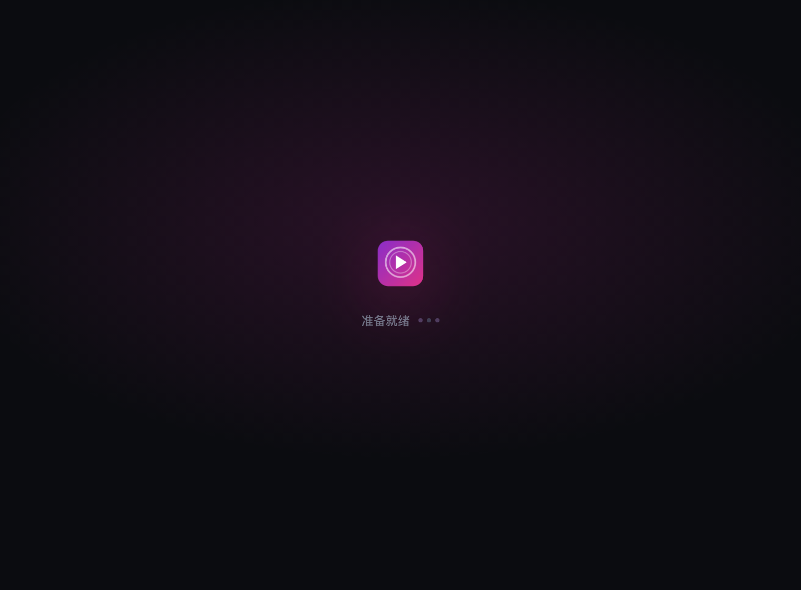
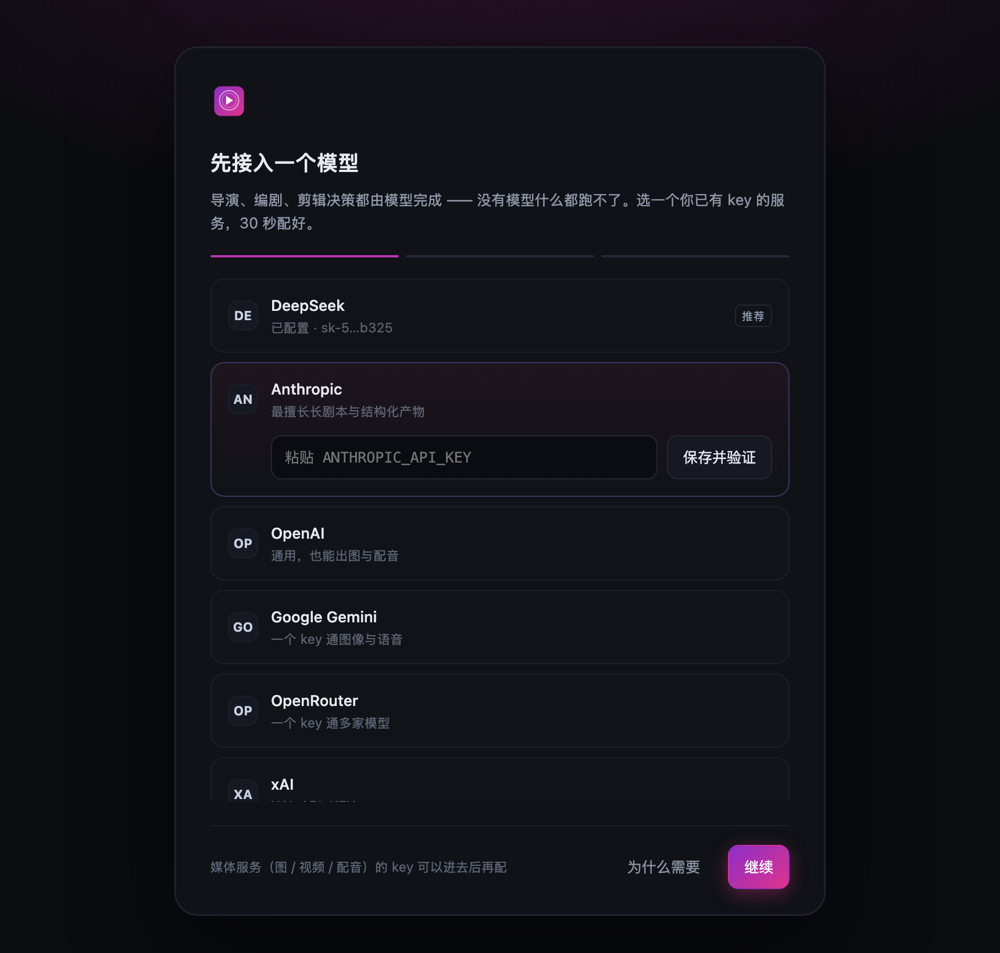
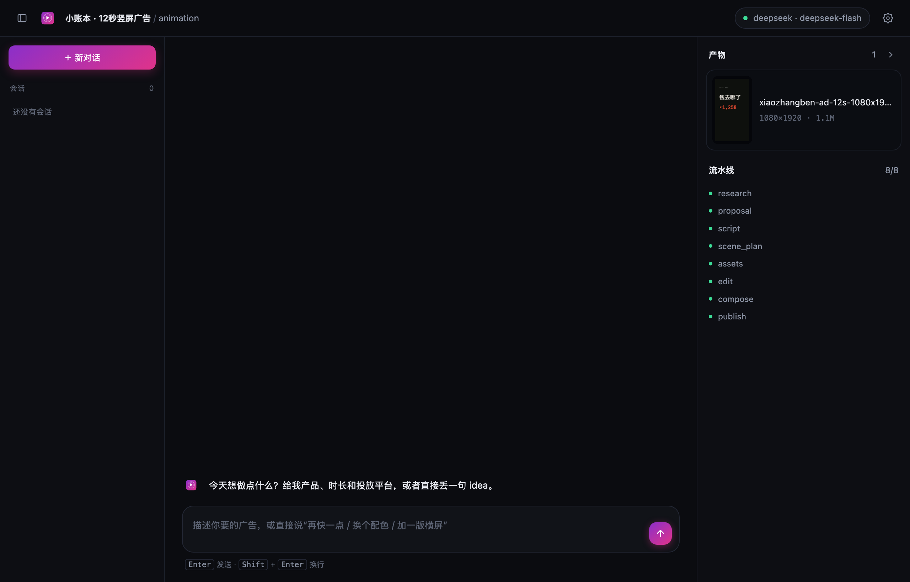
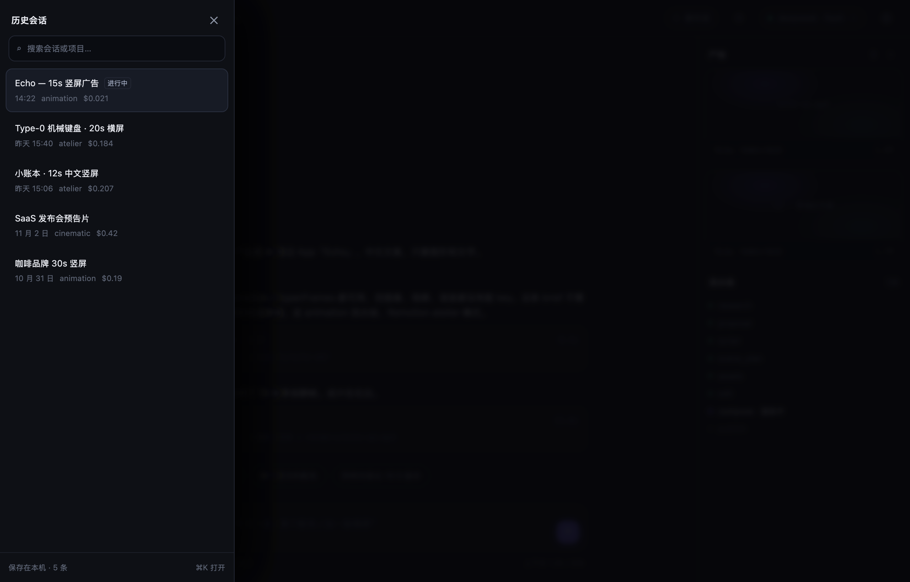

# 界面改版设计计划（v2）

> **路径说明（2026-11 拆分后）**：本文写于 Ad+ 独立成仓之前。当前布局为
> `~/AdPlus/`（Ad+ 代码：`adplus/`、`app/`、`frontend/`）+ `vendor/openmontage/`（上游 submodule）。
> 文中 `om_mcp.py` 现位于 `adplus/mcp/__main__.py`，`lib/{agent_bridge,quote,jobs}.py` 现位于 `adplus/`，
> `app/ui/*.html` 已由 `frontend/` 的 Solid 界面取代。


现状问题（来自实际使用反馈）：点设置没反应（已修，链接指错）；配置项和状态全堆在顶部；聊天输入框简陋；没有启动过程；没有"没配模型"的引导。

目标：**三屏、一条主线** —— 启动 → 配置模型（缺省强制）→ 工作台。工作台只留对话与产物，配置全部收进设置页。






> 三张图都是按最终 CSS 渲染出来的真实截图（headless Chrome 2× 输出），不是手绘稿。

---

## 1. 设计原则

1. **一屏一事**：启动只报进度，引导只配模型，工作台只做对话与看片。
2. **状态不占主视线**：能力矩阵、key 配置、流水线细节从顶栏移出，按需出现。
3. **阻断要解释**：没模型就不让进，但要写清楚"为什么必须有模型"。
4. **少即是默认**：顶栏最多两个可点元素（模型、设置）；其余留给内容。
5. **深色为唯一主题**：与产出的视频预览同色域，避免看片时被界面抢注意力。
6. **主色取自应用图标**：`#8B2FC9 → #E0338A` 渐变，按钮/进度条/选中态统一用它，纯色 `#B833AF` 作为不支持渐变处的回退。

## 2. 信息架构

```
启动 (splash)                      ← 后端预热时显示，2–4 秒
   │  健康检查通过
   ├─ 未配置模型 ──→ 首次配置 (onboarding, 强制)  ──→ 工作台
   └─ 已配置模型 ──→ 工作台
                        │
                        ├─ 对话（主）
                        ├─ 产物 ← 右侧栏，可收起
                        ├─ 流水线 ← 右侧栏下半，渲染中才有动效
                        └─ 设置（模态/独立页）：模型 · 媒体 key · Pi 集成 · 关于
```

路由（后端直接出页面，不起前端框架）：

| 路径 | 页面 | 进入条件 |
|---|---|---|
| `/splash` | 启动 | Tauri 窗口先加载它 |
| `/onboarding` | 首次配置 | `snapshot.models == 0` |
| `/` | 工作台 | 有模型 |
| `/settings` | 设置 | 任意 |

**硬门槛**：`/` 在服务端判断，若没有可用模型，302 到 `/onboarding`。这样无论从哪进、刷新、深链，都进不了工作台。

## 3. 关键流程

### 冷启动
1. Tauri 开窗即加载 `/splash`（此时后端可能还没起 → splash 页自己轮询 `/api/health`）。
2. 后端就绪后 splash 请求 `/api/bootstrap`：`{ready, has_model, models[], first_run}`。
3. `has_model=false` → 跳 `/onboarding`；否则跳 `/`。
4. 首帧内容 400ms 内出现；预热期间 logo 呼吸 + 三个点脉冲。

### 首次配置（阻塞）
- 一屏一选择：**选 provider → 填 key → 测试连接 → 继续**。
- 选中行展开输入；「测试连接」成功后显示绿点 + 可用模型数，并把它设为默认模型。
- 底部说明"媒体服务的 key 可以进去后再配"，给一个「为什么需要」的解释弹层。
- **继续按钮在模型验证通过前 disabled**，点击无效并有轻微摇动反馈。

### 工作台
- 顶栏：`Logo · 项目名 / 流水线` + 右侧 `模型胶囊` + `设置齿轮`。**不再有任何能力/费用常驻文本**（费用并入模型胶囊的 tooltip 与设置页）。
- 主列：消息流（底部对齐，短对话不悬空）+ 建议 chips + 输入框。
- 右栏（300px，可收起）：产物缩略图（点击内联播放）+ 流水线阶段（当前阶段有脉冲点）。

## 3.5 会话与面板控制

三件事都要显式可见，不做"藏起来靠猜"。

### 右侧面板开关

| 位置 | 控件 | 行为 |
|---|---|---|
| 面板标题右侧 | `›` 折叠图标 | 折叠；折叠后窗口右缘留一条 40×96 的竖条手柄（`‹`），点它展开 |
| 顶栏 | 无独立按钮 | 避免顶栏变拥挤 |
| 快捷键 | `⌘\` | 切换；状态记在 localStorage |
| 响应式 | 窗口 < 1040px | 自动折叠（不覆盖用户手动的展开意图，只影响初始值） |

折叠时主列自动居中加宽（720 → 820），保证对话不会被拉成一条细缝。

### 新对话（已改为左侧栏）

- **左侧栏顶部** `＋ 新对话`（`⌘N`），常驻可见；顶栏不再重复这个按钮。
- 点击后：若当前有渲染在跑，先弹确认（"还在渲染，开始新对话会中断吗？"→ 实际不中断，但在后台继续，历史里可见）。
- 新对话 = 新的 Pi session（`--session-id <uuid>`），右侧产物栏清空，流水线回到 research。

### 历史会话（已改为左侧栏）

- **左侧栏**常驻列出会话（标题 + 时间 + 体积），当前会话高亮；`⌘K` 跳到列表。
- 每行显示：标题（取首条用户消息前 28 字）+ 流水线标签 + 时间 + 该会话累计费用。
- 顶部搜索框过滤标题/项目名；底部显示"保存在本机 · N 条"。
- 点击恢复：加载该会话的完整消息流与产物（Pi 用 `--session <path>` 续跑，不丢上下文）。
- 删除：行尾 hover 出现 `⋯` → 删除（同时删除 Pi 的 session 文件）。

### 需要补的后端（当前不具备）

现在的 `app/pi_bridge.py` 用的是 `--no-session`，**根本没有历史**。已实测 Pi 1.5 的会话落盘格式：

```
--session-dir <dir>   →  <dir>/2026-11-04T08-09-11-249Z_<session-id>.jsonl
首行: {"type":"session","id":"demo1","timestamp":"…","cwd":"…"}
```

要做的改动：

1. `pi_bridge` 去掉 `--no-session`，改传 `--session-dir ~/Library/Application Support/Ad+/sessions`
2. 新增 `GET /api/sessions`（扫 `*.jsonl`，读首行取 id/时间，读首条 user 消息做标题）
3. 新增 `POST /api/sessions`（新对话：生成 `--session-id`）
4. 恢复会话：`pi --session <path>`，并把 JSONL 里的消息回放成页面上的气泡
5. 费用归到会话：`usage` 累计写入 `<session>.meta.json`

## 4. 组件规格

| 组件 | 规格 |
|---|---|
| 顶栏 | 高 52，底边 1px `--line-soft`，无阴影 |
| 消息 | 头像 26×26 圆角 8；正文 13.5/1.55；用户右对齐气泡，AI 左对齐无气泡 |
| 工具卡 | 1px 边线 + 12 圆角；`✓ 工具名 [MCP]` + 右侧耗时（等宽）；下方一行参数摘要，超出省略 |
| 建议 chips | 胶囊，1px 边线，hover 提亮；最多 3 个，由上下文生成 |
| 输入框 | 圆角 16，`focus-within` 有 3px 紫色柔光；auto-grow 44→160；**Enter 发送 / Shift+Enter 换行**；渲染中按钮变 Stop（方块图标） |
| 侧栏产物 | 卡片 12 圆角，缩略图 96 高，底部 `时长 · 分辨率` + 文件大小 |
| 流水线 | 逐行圆点 + 名称；done 绿、now 紫（带 3px 光晕）、pending 灰 |

## 5. 设计 token

```css
--bg:#0b0c10;  --surface:#111318;  --surface-2:#161922;
--line:#232734; --line-soft:#1b1f29;
--text:#e8eaf0; --dim:#8d95a6; --faint:#5d6474;
--accent:#b833af; --accent-soft:rgba(200,47,160,.16);
--grad:linear-gradient(140deg,#8b2fc9,#e0338a);  /* 品牌图标同款渐变 */
--ok:#3ddc97; --warn:#f2b544; --bad:#ff6b6b;
圆角: 8 / 12 / 16 / 20    字号: 11 / 11.5 / 12.5 / 13.5 / 15 / 19
间距: 4 的倍数           动效: 150ms 标准 / 2.4s 呼吸
字体: -apple-system 系统栈；数字与工具名用 SF Mono
```

## 6. 状态清单（每个都要有明确形态）

| 状态 | 表现 |
|---|---|
| 后端未就绪 | splash 呼吸 + "正在启动制作引擎" |
| 无模型 | 硬跳 onboarding，工作台不可达 |
| 模型验证失败 | 输入框红边 + 一行可读原因（不透传原始报错） |
| 会话未连接 | 输入框禁用，占位文案"先连接模型" |
| 流式输出 | 消息末尾光标；发送键变 Stop |
| 渲染中 | 工具卡显示计时；侧栏当前阶段脉冲 |
| 费用超预算 | 系统消息 + 自动中断（已有逻辑，改为醒目样式） |
| 工具失败 | 卡片红边 + 一行错误 + 「重试」 |
| 空项目 | 主列居中三条示例 brief，点击填入输入框 |

## 7. 实施拆解

| 阶段 | 状态 | 内容 | 验收 |
|---|---|---|
| **P1 路由与门槛** | ✅ 已完成 | `/splash`、`/onboarding`、`/api/bootstrap`；`/` 服务端 307 跳转 | 清空模型后刷新 `/` → 必落到 onboarding；配置后 → 落到 `/` |
| **P2 工作台重排** | ✅ 已完成 | 顶栏（新对话 / 历史 / 模型 / 设置）、消息流、工具卡、composer、右栏、面板折叠 | 顶栏四个控件可用；`⌘\` 折叠面板；Enter 发送、Shift+Enter 换行；短对话底部对齐 |
| **P2.5 会话** | ✅ 已完成 | 去掉 `--no-session`、`--session-dir`、`GET/POST /api/sessions`、历史抽屉、`--session` 续跑 | 新开对话产生新 session 文件；历史抽屉列出并恢复；恢复后上下文连续 |
| **P3 设置页重做** | ✅ 已完成 | 分组（模型 / 媒体 / Pi / 关于）+ 搜索 + 状态列 | 能力信息只出现在设置页；保存后无需重启即生效 |
| **P4 打磨** | ✅ 已完成 | 空态、错误态、动效、键盘可达性（Tab/ Esc） | 全部状态清单可复现；Tab 能走完主流程 |

每阶段单独可发；P1 独立价值最大（解决"配不了就用不了"的死锁）。

## 8. 不做的事

- 不引入前端框架/构建链：仍是服务端直出的 HTML + 原生 JS，保持 14 MB 分发包。
- 不做浅色主题（产出的视频预览在深色下更准）。
- 不做多窗口；但**一个项目可以有多条会话**（历史抽屉里切换），不是一项目一会话。
- 不把 Backlot 故事板塞进侧栏（它是独立页面，后续单独评估）。
