# 改写（Restyle）P0 Spike 测试报告

> 日期：2026-11-07
> 参考片：`uploads/20261107/ref-footbath-32s.mp4`（32.07s / 720×1280 / 30fps）
> 目的：在写 UI 之前，验证“保留人物表演和商品、换背景”这条路线到底能不能看。

---

## 1. 测试环境

| 项 | 值 |
|---|---|
| 人像分割 | macOS Vision `VNGeneratePersonSegmentationRequest`（PyObjC，quality=accurate） |
| 商品 / 杂项遮罩 | OpenCV 5.0（HSV + GrabCut） |
| 背景板 | MiniMax image（cn region，9:16） |
| 合成 / 编码 | Python + OpenCV + ffmpeg |
| 机器 | 本机 macOS / Apple Silicon |

参考片结构（已写入 `tests/fixtures/restyle/reference_expected.json`）：22 镜、4 场景、3 造型、22 条字幕。

---

## 2. 结果总览

| 镜头 | 内容 | 做法 | 结果 |
|---|---|---|---|
| s03 | 人坐在长凳上，卧室 | 全背景替换 + 保留长凳 | **失败**：长凳成矩形补丁 / 人物漂浮 |
| s03 | 同上 | 只换上半墙/窗帘 | **失败**：有明显横向接缝 |
| s07 | 人坐在黄沙发上，腿在桶里 | 全背景替换 + 保留沙发 | **失败**：沙发 mask 成块，桶边缘透出背景 |
| s18 | 手拎桶，沙发/地毯 | 全背景替换 | **单帧通过**；连续帧失败 |

单帧最好的一版（s18）：

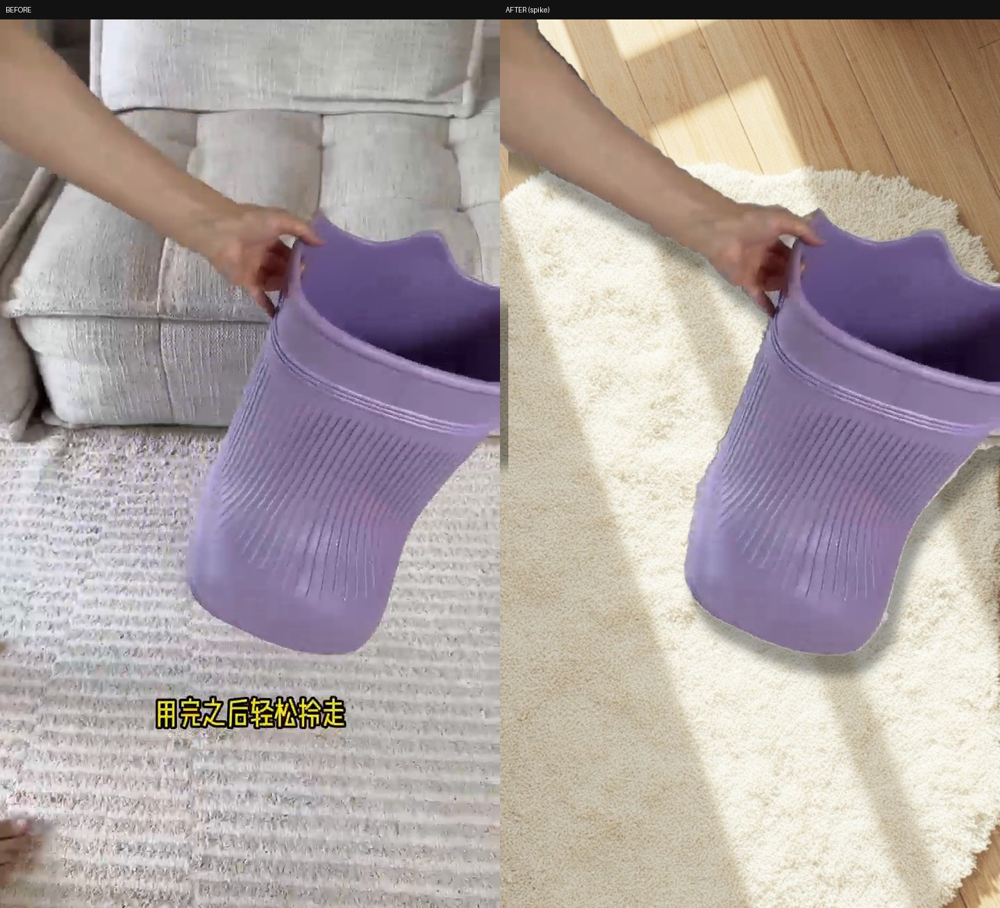

- 商品完整、手部边缘可接受、阴影自然；
- 如果只看静帧，这一版已经能读成“同一个桶，换了一个地毯/房间”。

连续帧失败（s18，1.15s）：

[查看 1.15s 片段](clips/s18_new_bg_v2.mp4)

- 第 1–3 帧正常；
- 第 4 帧开始，Vision 把**沙发**当成了人，alpha 覆盖全屏，新背景被吃掉；
- 这不是合成问题，是**单帧人像分割不稳定**。

---

## 3. 逐镜分析

### 3.1 s03：人 + 长凳

原片：

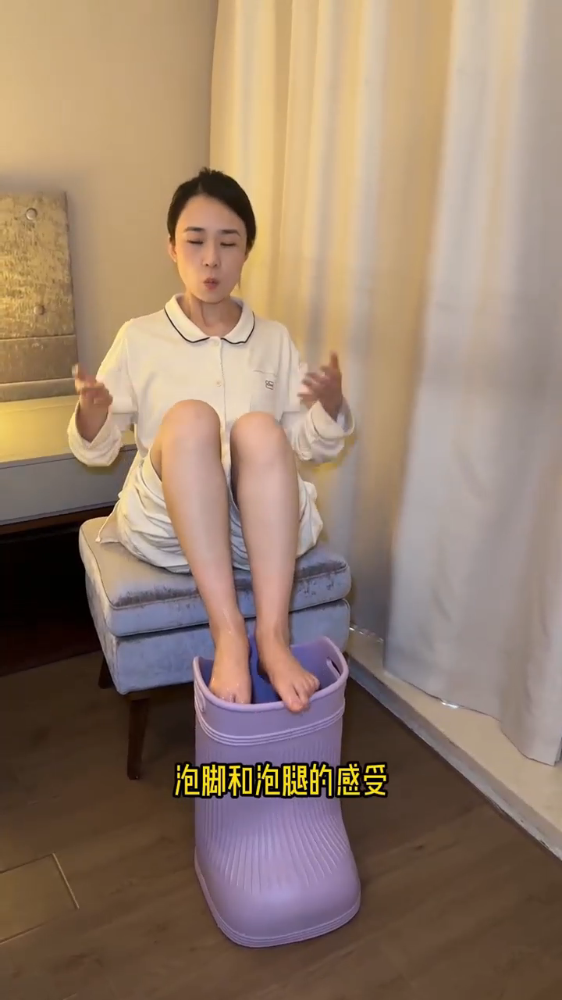

全背景替换（失败）：

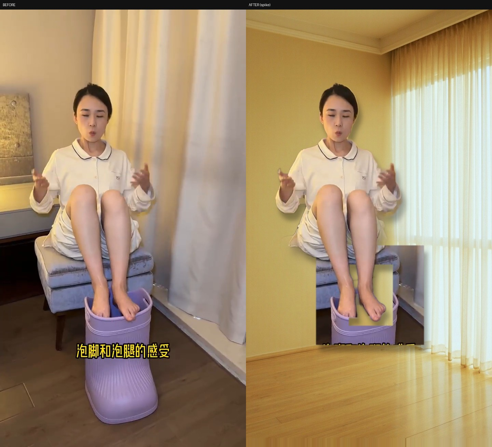

问题：

1. 长凳是**接触家具**，不属于人像 mask；如果不单独保留，人物会悬浮。
2. 用多边形 + GrabCut 保留长凳时，mask 包含了大块背景空气，形成明显的矩形补丁。
3. 新背景板的地平线 / 透视和原片不一致，长凳像贴上去的。

只换上半墙/窗帘（失败）：

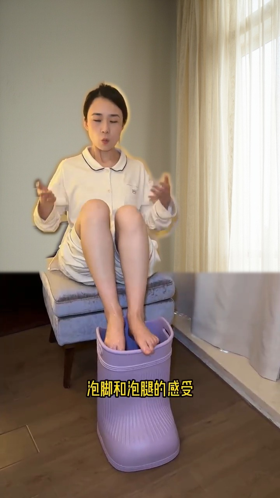

问题：横向接缝明显，墙色/窗帘在 y≈700 处突变。

**结论**：s03 不适合“全背景替换”。要么保留整块下半景（长凳+地板），只做墙面/窗帘的柔和换色；要么使用一张**带同位置长凳的场景板**。

### 3.2 s07：人 + 黄沙发

原片：

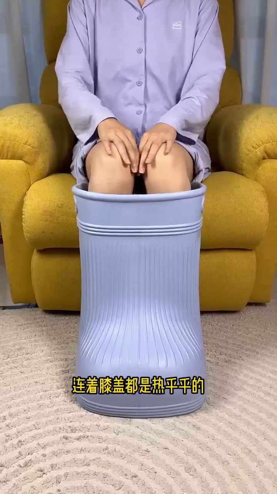

全背景替换（失败）：

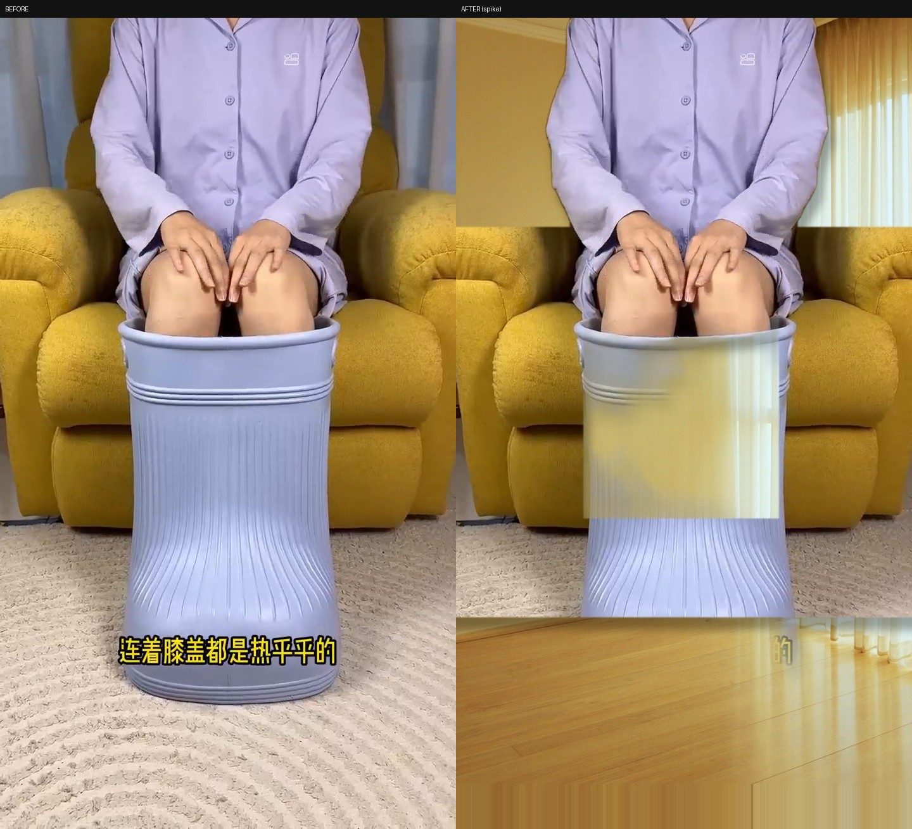

问题：

1. 黄沙发占画面 70% 以上，可替换的背景只有顶部一条墙/窗帘。
2. 沙发是接触家具，必须保留；保留后“换背景”的视觉收益很小。
3. 商品桶和浅紫睡衣颜色接近，mask 容易混；桶边缘透出黄色背景。

**结论**：s07 建议默认 `keep`（保留原背景），或只做轻微墙面/色温变化。不要为了“每镜都换”牺牲真实感。

### 3.3 s18：手 + 桶 + 地毯

原片：

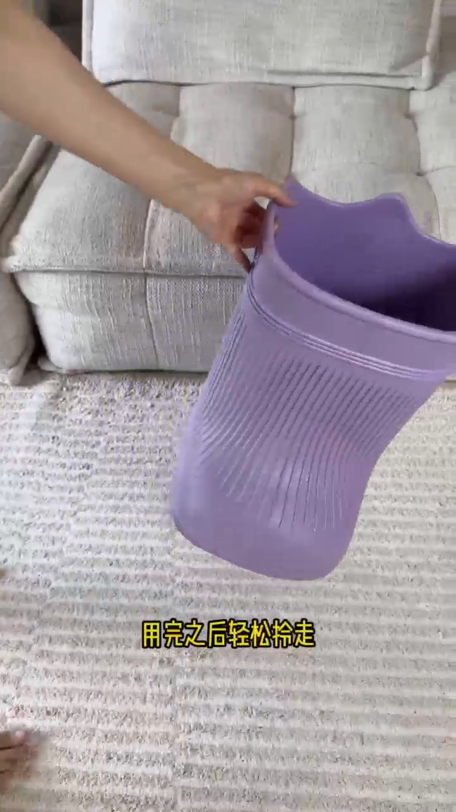

单帧合成（通过）：

- 商品像素完整保留；
- 手部/桶边缘可接受；
- 新地毯 + 阴影成立。

连续帧（失败）：

- Vision 在部分帧把沙发识别成“人”，alpha 变成大面积白色；
- 尝试了 ROI 限制和上一帧 fallback，仍会漏进沙发；
- GrabCut + 颜色种子能抓到桶，但会带进右下角地毯，且桶左侧边缘缺失。

**结论**：手部/商品特写不能只靠 Vision。需要 **关键帧手绘 mask + GrabCut / 光流跟踪**，或直接默认 `keep`。

---

## 4. 关键发现

### 4.1 Vision 对“完整人像”很好，对“手/商品特写”不稳

- s03/s07 的完整人像 mask 质量很好，头发、衣服、腿、脚都完整；
- s18 只有手和桶时，Vision 会把沙发/地毯当成主体；
- 单帧速度约 **0.15s / 帧**（720p），32s 视频约 2.4 分钟，可接受。

### 4.2 不要对二值 mask 做 EMA 累积

第一版为了防抖，做了 `prev*0.45 + current*0.55` 再阈值化。结果 mask 逐帧膨胀，几帧后覆盖全屏，新背景被吃掉。

正确做法：

- 每帧独立 mask + 空间羽化；或
- 3–5 帧中值滤波；不要用“上一帧 + 当前帧”再阈值化。

### 4.3 接触家具是背景替换的隐藏难点

- 长凳、沙发、椅子、床：人物坐在上面/靠在上面，属于“接触家具”；
- 如果只保留人 + 商品，家具会消失，人物悬浮；
- 如果保留家具，mask 容易带进背景空气，形成补丁；
- 如果换整张场景板，家具位置/透视/光影很难对齐。

**产品上必须有“支撑物/家具”这一层**，默认 `keep`；只有场景板自带同位置家具时才允许 `replace`。

### 4.4 被手拿着的商品会被 Vision 算进“人”

s18 的桶被手拎着，Vision 的 person mask 直接包含了桶。好处是合成时桶被完整保留；坏处是如果后续做“服装换色/肤色”，会把桶一起染色。

**规则**：商品 mask 必须从 person mask 中扣除，只用于“保留”，不参与人物外观调整。

### 4.5 背景板对齐是手工活

- 生成场景板时，地平线、相机高度、透视都不受控；
- 需要每镜 `fit: {scale, dx, dy}`，甚至单应性；
- 固定机位可以先做；运动镜头建议默认 `keep`。

### 4.6 性能可行

- Vision 0.15s/帧；
- 32s / 约 960 帧 → 2.4 分钟纯分割；
- 加合成/编码，720p 全片 5–8 分钟可达；
- 1080p 是 720p 源上采样，不会增加细节。

---

## 5. Go / No-Go

**结论：Conditional Go（有条件通过）。**

可以继续做 UI 和骨架，因为：

- 单帧合成质量已经能看；
- 商品保留、阴影、边缘处理路线成立；
- 性能满足 32s 广告。

但必须先加两件事，才能承诺“换背景”：

1. **Mask fallback**：手部/商品镜头不能只靠 Vision；需要关键帧手绘 mask + GrabCut/光流跟踪，或默认 `keep`。
2. **支撑物层**：长凳/沙发/椅子作为独立层，默认保留；不要强行全背景替换。

补充：直接生成 A/B 进一步确认，商品/手部镜头不能交给生成模型重画（见 §6）。**不建议**在 v1 承诺“22 镜全部自动换背景”。建议：

- 自动识别 + 建议 `keep` / `replace`；
- 可替换镜头覆盖率目标 ≥ 60%；
- 高风险镜头默认保留，用户可手动开。

---

## 6. 直接生成 A/B（补充）

为了回答“AI 能不能直接生成”，用两种模型各跑了一条：

### 6.1 s18：Seedance 2.0 reference_to_video

- 输入：s18 原帧 + 地毯场景板 + “保留手和桶、换到新地毯”的 prompt；
- 输出：4.0s / 496×864 / 24fps；
- 成本：约 **¥1.87**（`estimated_cost_cny`）。

结果：

- 房间换了，地毯/木地板/绿植都成立；
- 但 **桶被重画**：变宽、变矮，桶口、提手、竖向条纹、按摩点都和原商品不一致；
- **手也被重画**，和原手不是同一只；
- 字幕消失。

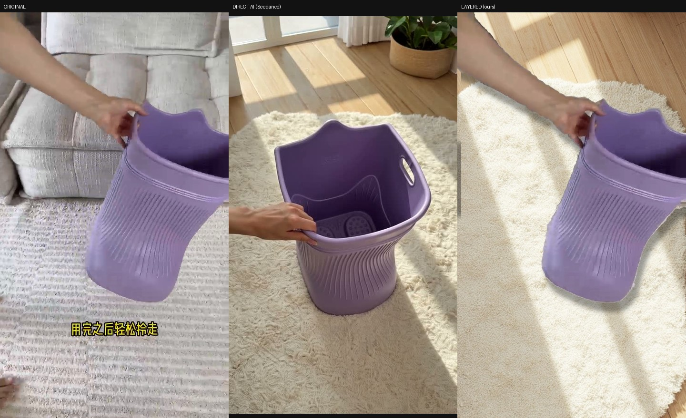

### 6.2 s03：真人镜头

- **Seedance 2.0 reference_to_video：直接拒绝**  
  `InputImageSensitiveContentDetected.PrivacyInformation`（输入图含真人）。
- **MiniMax Hailuo 2.3 Fast image_to_video：可以跑**  
  输出 5.9s / 768×1364 / 24fps，成本 **$0.08**。

结果：

- 人物脸、身材、腿都和原片不一样；
- **桶也变了**（更矮、更宽、条纹和桶口不同）；
- **背景没有换**，还是原房间；
- 字幕消失。

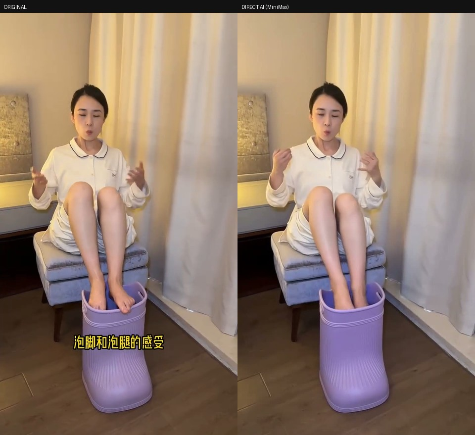

### 6.3 结论

1. 直接生成不是“换背景”工具：image-to-video 会锚定首帧，背景不会按 prompt 换；reference-to-video 会把人物/商品一起重画。
2. 真实人物素材会被部分平台直接拒绝；能跑的模型也会让身份漂移。
3. 商品保真无法保证；这条片的商品是主角，不能接受。
4. 字幕、时间线、音频仍然要后期处理，直接生成并没有省掉这些。
5. 成本：两条 4–6s 约 **¥1.9 + $0.08**；22 镜全直接生成会线性放大，且需要多次重试。

**判断**：直接生成只适合“无商品接触、无真人特写、允许重画”的镜头；商品/手部镜头继续走分层合成。

## 7. 对实施计划的修改

1. 数据模型加 `objects` 组（长凳/沙发/椅子/床），默认 `keep`；
2. P2 加 “mask fallback” 任务：关键帧手绘 + GrabCut + 光流/跟踪；
3. P2 验收从“22 镜全换”改为“可替换镜头 ≥ 60%，高风险镜头保留”；
4. 风险表加 “手部/商品特写 Vision 失效”；
5. 场景板支持 `fit` + 可选单应性；运动镜头默认 `keep`；
6. 单帧预览先上线，连续帧稳定性作为 P2 的 gate。

---

## 8. P0.5 补充（2026-11-07）

### 9.1 s18：关键帧 mask + 光流

做法：

- 在 4 个关键帧（1 / 12 / 24 / 36）手绘手 + 桶的粗 mask；
- 每个关键帧用颜色种子 + 填洞修正；
- 段内用 Farneback 光流把 mask 传播到每一帧。

结果：

- 比 Vision 稳定，不再整屏变白；
- 但仍有边缘问题：桶口/桶底漏一点，沙发和地毯的残片偶尔被带进来；
- 关键帧切换处有轻微跳变。

片段：[clips/s18_new_bg_kf.mp4](clips/s18_new_bg_kf.mp4)

**判断**：手部/商品特写要达到可用，需要画笔级修边或 SAM2 级跟踪；启发式光流不够。v1 这类镜头默认 `keep`。

### 9.2 s03：墙面 / 窗帘重制（通过）

不再换整张场景板，改为：

- 墙面：LAB 调色，去黄、加冷；
- 窗帘：提亮、去黄；
- 软 mask + 41px 羽化，人物 / 长凳 / 商品 / 字幕全部保留。

结果：

- **无接缝、无漂浮、无补丁**；
- 房间从暖黄变成冷灰，观感自然；
- 商品、人物、字幕完全不动。

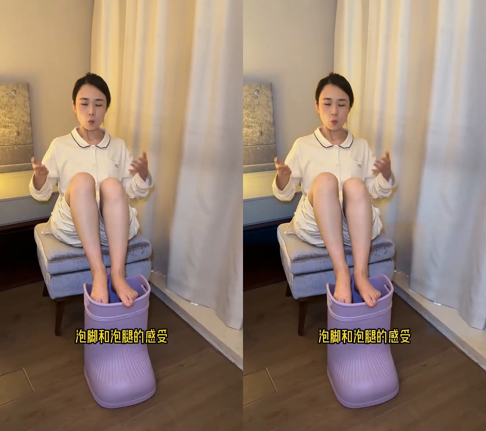

**判断**：这是接触家具镜头的安全路径。v1 的“换背景”应该包含这一档，而不是只做整间房替换。

强变体（墙更冷、地板加深）视觉更明显，但地板在 y≈945 出现水平接缝，原因是地板 mask 是一条直线。对比：[pairs/s03_relight_strong_compare.jpg](pairs/s03_relight_strong_compare.jpg)。

结论：**墙面 / 窗帘 relight 可以先上；地板 relight 需要按几何/颜色生成 mask，放到 P2 后半，不作为 v1 默认。**

### 9.3 收敛后的 v1 背景能力

| 能力 | 状态 |
|---|---|
| 墙面 / 窗帘调色、换材质 | **可用** |
| 地板调色 | 需几何/颜色 mask；强变体有接缝，P2 后半 |
| 安全镜头（无手/商品接触）整间房替换 | 可用（s18 单帧通过） |
| 手部 / 商品特写整间房替换 | 不可用，默认 `keep` |
| 接触家具整间房替换 | 不可用，默认 `keep` |

## 9. P1 骨架（2026-11-07）

已落地：

- `adplus/restyle/{store,analysis,plans}.py`
- `GET/POST /api/restyle`、详情、读片、plan patch
- `/restyle` 列表 + 拖拽上传 + 权利确认
- `/restyle/:id` 工作台：播放器、镜头条、读片卡、改动幅度、场景组、字幕/商品/声音卡
- 自动保存 + revision 409

实测：

- 参考片读片 **7.5–8s**：22 镜 / 4 场景 / 3 造型 / 21 条字幕（OCR 需校对）
- 后端新增 9 个测试通过；前端 `pnpm build` 通过
- 项目列表默认过滤改写项目；`?include_restyle=true` 可看到

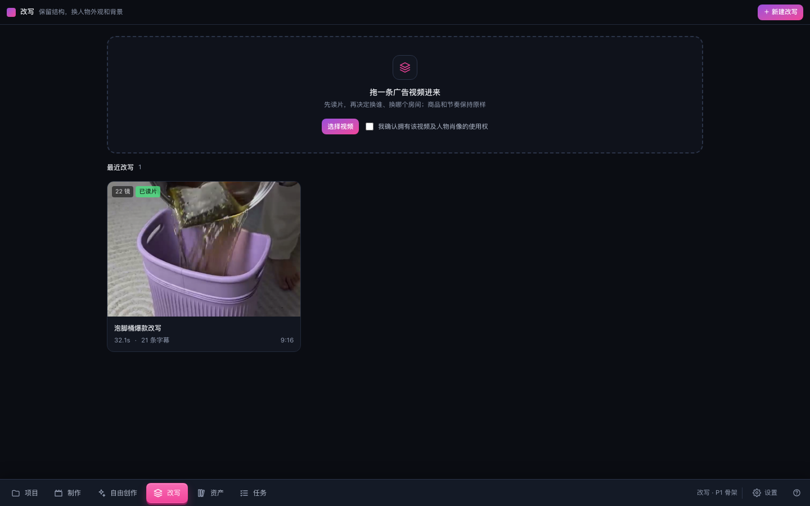

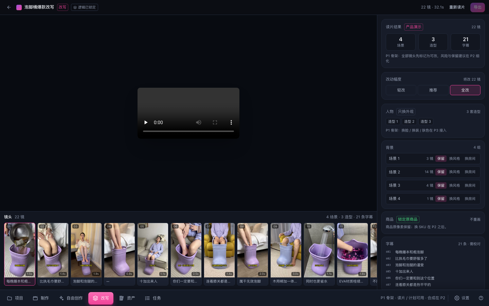

已知缺口：

- OCR 文字准确率不够，P1 标记“需校对”；
- 工作台只有分析和计划，没有合成/预览；
- 截图里播放器是黑帧，是 headless Chrome 不解码视频；`/api/media` 已确认 206 可播。

## 10. Windows-first 修订（2026-11-07）

Windows 是主平台，P1 的 macOS 验证不能代表 Windows 可交付。已做的代码调整：

- 新增 `adplus/restyle/segment.py`：`PersonSegmenter` 抽象，Windows 默认 MediaPipe / ONNX，macOS Vision 仅可选；
- `analysis.py` 工具路径支持 `ADPLUS_FFMPEG` / `ADPLUS_FFPROBE` / `ADPLUS_TESSERACT`；
- Windows 子进程加 `CREATE_NO_WINDOW`，避免黑框；
- 改写路径统一 `as_posix()`，避免 Windows 反斜杠进入 API / JSON；
- 新增 `requirements-restyle.txt`（Windows Python 3.12）和 [Windows 构建计划](../../windows-build-plan.md)；
- 新增 `.github/workflows/windows.yml` + `scripts/restyle_smoke.py`：在 `windows-latest` 上装 ffmpeg、跑读片 smoke、后端测试和前端 build；
- 新增 `scripts/build_backend.py`（PyInstaller onedir）和 `build-backend` CI job：构建 `adplus-backend.exe` 并做 `/api/health` 检查；
- Rust shell 增加 Windows sidecar 查找与 `CREATE_NO_WINDOW` 启动；`cargo check` 在 macOS 通过。

仍未完成：

- Tauri 已加 `tauri.windows.conf.json`（NSIS + `.ico`）；Python sidecar / PyInstaller / Windows CI 仍未做；
- Python sidecar 没有 PyInstaller 包；
- Windows CI 工作流已写好，但还没在 GitHub 上跑过；没有干净机器安装验证；
- 分割模型许可（RVM GPL-3.0 需谨慎）未定。

结论：**W0（Windows 安装包 spike）优先于 P2**。W0 不过，不继续做 Windows 主平台的 P2。

## 10.1 Windows CI 绿灯（2026-11-09）

`windows-restyle` #7（`fa2d6e4`）两个 job 都通过：

- `test`：Python 3.12 + ffmpeg + 读片 smoke + 20 个 focused tests + 前端 build；
- `build-backend`：PyInstaller 构建 `adplus-backend.exe`，启动后 `/api/health` 通过，artifact 已上传。

这证明 **Windows 后端 / 依赖 / sidecar 能跑**，但还不等于桌面 App 可用：

- 还没有 NSIS 安装包；
- 还没有随包 ffmpeg / tesseract / 字体；
- 还没在干净 Windows 机器安装并打开工作台。

## 11. 下一步

1. **W0（优先）**：Windows 安装包 spike——Tauri NSIS/MSI + Python 3.12 sidecar + 随包 ffmpeg/tesseract/字体；在干净 Windows 机器跑参考片读片。
2. W0 通过后 P2：`PersonSegmenter`（MediaPipe/ONNX）、静帧 `/frame`、relight 预览；硬镜头默认 `keep`。
3. P3：人物外观 + 字幕校对 + 声音；双平台验收。

## 附：产物索引

| 文件 | 说明 |
|---|---|
| `frames/s03.png` / `s07.png` / `s18.png` | 原始帧 |
| `frames/s03_mask_pair.jpg` | Vision 人像 mask 叠加 |
| `frames/s18_person_overlay.jpg` | 手部镜头 Vision mask（包含桶） |
| `frames/s18_grabcut_10b_overlay.jpg` | GrabCut + 颜色种子（带进地毯） |
| `pairs/*_before_after.jpg` | 原片 / 合成对比 |
| `clips/s18_new_bg.mp4` | 第一版连续帧（EMA 膨胀，失败） |
| `clips/s18_new_bg_v2.mp4` | ROI + fallback 版（仍失败） |
| `direct/s18_direct.mp4` | Seedance 直接生成 s18（4s） |
| `direct/s03_minimax.mp4` | MiniMax 直接生成 s03（6s） |
| `direct/s18_compare.jpg` / `s03_compare.jpg` | 原片 / 直接生成 / 分层合成 对比 |
| `clips/s18_new_bg_kf.mp4` | 4 关键帧 + 光流跟踪版（仍不够干净） |
| `pairs/s03_recolor2_compare.jpg` | s03 墙面/窗帘重制（通过） |
| `ui-restyle-list.png` / `ui-restyle-workbench.png` | P1 列表 / 工作台截图 |
| `plates/soft-room.jpg` / `neutral-room.jpg` / `rug.jpg` / `floor-tile.jpg` | 生成的场景板 |
