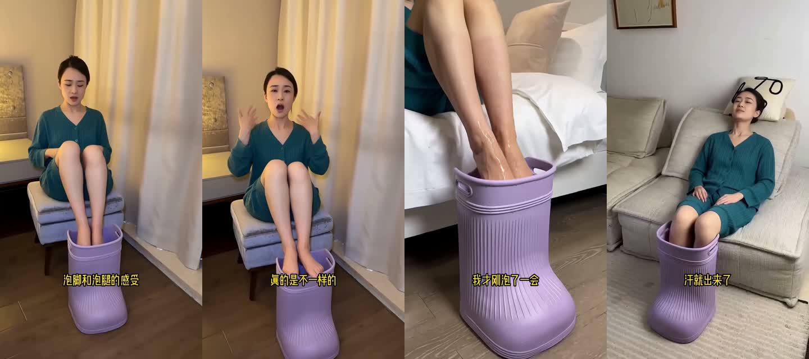

# MiniMax H3 4s outfit test (2026-11-09)

Input: `source_4s.mp4` (2.9s–6.9s of the reference ad)
Output: `output_4s.mp4`
Model: `MiniMax-H3`, `reference_to_video`, 4s, 9:16, 2K

Prompt:

> 只把女子的白色睡衣上衣和短裤换成深青色针织家居服，保留人物脸部、手、腿部、紫色泡脚桶、背景、镜头运动和原节奏不变。不要改变商品。不要改变人物身份。

## 结果

| 项 | 结果 |
|---|---|
| 换装 | ✅ 白色睡衣变成深青色针织开衫 |
| 人脸/身份 | ✅ 第一帧接近 |
| 商品桶 | ⚠️ 第一帧接近，形状/纹理有变化 |
| 背景 | ❌ 后续帧出现床/沙发，场景被重新生成 |
| 字幕 | ❌ 原字幕变成新文案，字形也变了 |
| 结构/切点 | ❌ 4s 内出现新镜头，不是原片结构 |
| 时长 | ❌ 4.459s（输入 4.0s） |

## 关键结论

MiniMax 的 `reference_to_video` 是**参考生成**，不是**原片局部编辑**。它会把参考视频当“风格/内容参考”，重新生成一条新广告。

- 第一帧看起来接近，是因为它参考了输入；
- 后续帧会自由补镜头、换背景、换字幕；
- 商品和结构无法按像素锁死。

**所以 MiniMax 不能作为“同一条广告只换装”的主链路。** 它只适合：

- hero 镜头/概念参考；
- 背景板/空镜；
- 不要求原片结构的二创。

## 对计划的影响

- 继续保留 MiniMax 配置和 provider 入口，不删；
- M0b 结论：**No-Go for main path**；
- v1 主链路回到本地 L1 + 语义 garment mask；
- 如果未来 MiniMax 出真正的 video_edit/区域重绘，再重新评估。
